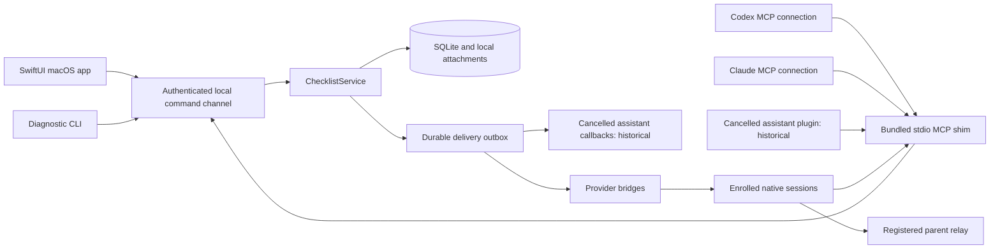

# Architecture

**Scope update:** personal-assistant integration was cancelled on 22 October 2026 (CL-3 and CL-22), with no active assistant UI/setup. Its diagram branches, source and contracts below are historical reference, not planned features or release requirements; current worker sessions remain ticket-attached.

The local development app/service/MCP are implemented. This document includes the full release target; [implementation status](implementation-status.md) distinguishes current source support from remaining qualification.

## Process boundary

Ship one app bundle containing the UI, `ChecklistService`, and `checklist` executable. The MCP server is part of this bundle, not a separately installed package. The executable supports `mcp`, service start/status, diagnostics, and export; it does not embed a model. Each MCP client starts a lightweight stdio shim. All shims and the UI talk to the same service. Only the service writes the store. No caller opens the SQLite file directly.

Use Swift 6, SwiftUI, focused AppKit bridges, SQLite through a maintained Swift wrapper, and the official MCP Swift SDK. Evaluate and pin dependency versions during the initial packaging spike; the SDK's documented protocol support must be tested against both installed clients. Do not implement JSON-RPC/version negotiation from scratch. No Python or Node runtime is required in the distributed app. The [official Swift SDK](https://github.com/modelcontextprotocol/swift-sdk) is the starting point; its advertised version is not proof of support for every newer MCP extension.

## Service lifetime and IPC

Use an authenticated XPC/Mach service registered through the supported macOS service mechanism. Package and verify it under the same signing identity as the app and MCP executable. **On-demand infrastructure startup is required:** once the bundled integration is installed, `checklist mcp` ensures the service is running before serving normal tools, whether or not the app window is open. Agents do not need to ask the owner to manually open the UI. Also expose `checklist service start` and `checklist service status` for diagnostics. Starting coordination infrastructure does not start a model or schedule.

The native app bridges synchronous XPC waits through a Dispatch queue, leaving Swift's cooperative executor free to deliver replies and start other loads. Owner reads and temporary preview-hold releases have a 30-second reply deadline; a lost reply reaches the existing visible read error state. Ordinary mutations still wait for their original command receipt, and a deadline never cancels a service command or authorizes a new command ID. A verified preview remains usable if releasing its temporary reader hold cannot be confirmed; the view shows a warning and the service lease expires normally.

Concurrent cold starts use launchd/service identity and a single-instance handshake; exactly one service owns the store. Bound startup to a proposed 10-second deadline and at most one diagnostic retry for a transient start failure. Two identical failures stop with a useful repair message. Never create another store/service or fall back to a random listener. Protocol stdout stays clean; startup logs go to stderr/redacted diagnostics. Missing integration registration, supported native context or real background-item permission returns a concrete setup-required result, not guessed access. A verified native Codex/Claude conversation in an unregistered folder starts the MCP server with `service_info` and `project_create`, without project enrollment or a stored credential. Creation binds only its actual verified workspace and atomically creates its worker session/enrollment/grant; the same MCP connection then completes bootstrap and announces its full tools once.

Explain service status in Settings. Closing a window, quitting the UI, stopping coordination, and pausing dispatch are distinct actions. The coordination service can remain available while the UI is closed and can be relaunched on the next authorized agent connection. Stopping the service leaves durable data and pending deliveries intact; a separate dispatch pause persists across startup and prevents new claims. Launch at login remains optional and off initially.

Use [SMAppService](https://developer.apple.com/documentation/servicemanagement/smappservice) for the supported registration path after a packaging spike proves the chosen bundle layout. Development uses an explicitly launched, scoped local service. Do not silently install a launch agent or edit the user's provider configuration during development.

The service checks caller identity and an enrolled capability context. The UI can author owner decisions and human answers; agent MCP credentials cannot. Each MCP connection binds to one authenticated context: an enrolled workspace worker/reviewer installation plus project/session generation and role capabilities, or an automatically bootstrapped existing host-owned observer/messenger assistant principal plus granted projects, actual native conversation generation and its narrow capabilities. An assistant uses the latter and does not register a worker session. Every subsequent call is checked against that binding. A caller-supplied display name, `origin`, model name, or session ID is never authentication.

Primary connection is automatic from actual provider-thread use of the bundled CLI/MCP. Service authentication pins the observed signed native host PID plus kernel start time, execution domain and actual kernel cwd. Codex host-exported thread IDs remain observations, not signed exact-thread attestations. Review excludes actual contributor principals/installations/sessions; a separate non-contributor subagent may review on the same authenticated host. Claude native registry PID/session/workspace/socket are independently cross-checked. An ordinary worker or manually entered name cannot fabricate a verified Dot identity. Actual worker diagnostics/recovery belong to tickets; no assistant settings/grant UI is active. Use in Codex can prepare a native composer; user Send, real thread creation/attachment and claim remain distinct. A supported explicit host-native creation API must return the actual identity; other providers retain honest fallback behavior.

This is cooperative isolation between local clients, not a security boundary against malware running as the owner. Document that limit instead of claiming that a local agent with unrestricted filesystem access cannot read local credentials. Do not expose a public/network listener in the first release. An explicitly connected assistant feature may send signed outbound HTTPS notifications to verified dot-host callbacks under the owner's event subscriptions; this is not a hosted Checklist database or inbound listener. If a later adapter needs loopback HTTP, it must add origin validation and explicit authentication in a separate change.

## Modules

The implemented initial shared package is [ChecklistShared](shared-modules.md): Domain values, read-method Contracts and pure Application capture planning. The remaining table describes architectural responsibilities, including later extractions; persistence/native adapters remain in their current root targets.

| Module | Owns | Does not own |
|---|---|---|
| ChecklistDomain | State transitions, eligibility, policy evaluation, claim/review/triage invariants | UI, SQL, provider APIs |
| ChecklistStore | Schema migrations, transactions, queries, command receipts, outbox, consistent backup | Routing decisions or native messaging |
| ChecklistService | Authenticated commands, orchestration of transactions, change subscriptions | Model execution |
| ChecklistMCP | Protocol negotiation, schemas, tool result conversion, session binding | Its own independent store |
| ChecklistBridges | Enrolled native endpoints, capability probes, message transport and receipts | Task completion decisions |
| ChecklistApp | Navigation, task editing, human requests, Finder selection, policy preview | Direct SQL writes |
| ChecklistTransfer | Source adapters, preview, mapping, atomic import/export and receipts | Live synchronization with old boards |

Keep providers behind a capability interface: identify session, inspect presence, enqueue message, report transport receipt, open supported deep link, and optionally stop/steer where verified and authorized. A missing capability has an explicit unavailable result. Provider identifiers/capabilities and verified existing assistant display snapshots are separate data, not switch statements in task logic; the UI needs no model catalog or profile designer.

The implemented [provider-plugin boundary](provider-plugins.md) adds `ChecklistProviders`, a Foundation-only root target holding versioned contracts and reviewed bundled implementations. Core, Bridges, Service and App consume its validated registry; provider-specific native I/O remains in Bridges, with service-owned kernel/signature/grant checks. The acyclic [workspace graph](monorepo-workspace.md) records these edges. There is no arbitrary code loader, second persistence engine or automatic model runtime. The [orchestrator](project-orchestrators.md) and [optional content](conversation-content.md) proposals reuse these boundaries and remain planned.

## Storage and consistency

The detailed [database and storage specification](database-storage.md) defines table groups, composite keys/indexes, staging/commit/cleanup, consistent filesystem-inclusive backup, WAL/migration/restore and failure behavior. [Project settings](project-customization.md) and [assistant integration](assistant-plugin.md) share this same store. No plugin-specific database or per-project fake data location.

Store data beneath `~/Library/Application Support/Checklist/`: the SQLite database, managed attachment copies, backups, and non-secret logs. Store provider credentials in Keychain. Keep IPC endpoint metadata and capability tokens out of project files, task exports, and normal logs. Directory permissions are owner-only.

Use foreign keys, WAL, bounded busy handling, and short write transactions. Every mutation writes current projections, append-only events, command receipt, and any outgoing deliveries atomically. External calls happen **after** commit. A crash after the provider accepts a message but before its receipt is stored is handled by an idempotent provider message ID where supported; otherwise mark delivery uncertain instead of blindly duplicating it.

Use one monotonically increasing store event sequence for ordering, UUIDs for durable identity, and UTC timestamps for storage. The UI renders in the user's timezone. A database clock/lease is not a wall-clock proof that an external process stopped.

Project-bearing tables use `(project_id, entity_id)` unique keys and composite foreign keys. Queries require a project scope unless they are explicit owner-only cross-project dashboard queries. Global dashboard rows always include project identity. Full-text search is filtered by authorized projects before ranking or returning snippets.

## Production context and artifact identity

Keep the write model separate from the compact context projection: current brief/outcome/next action, project brief/pinned decisions, unresolved findings and owner direction, current attempts, artifact manifest and recent messages. Always link summaries to originals and keep history retrievable. Draft capture needs only project/title; readiness is a separate validated command, not a fake lifecycle status that enables pickup.

A review claim binds one review request, gate and immutable manifest; v1 permits one active review/approval per task. Tests execute in the captured environment or under a reservation excluding every relevant writer, with fingerprints before and after execution. A test in another mutable checkout is not evidence. Human candidate approval binds the same artifact/gate identity. Replacement bytes invalidate the affected request/verdict; filename equality is irrelevant.

Canonicalize writable workspace roots with symlinks and filesystem case behavior. Reject physical overlap between projects in v1 rather than claiming database scope prevents filesystem edits from colliding. Shared read-only references are allowed. Scope expansion is an atomic reservation transaction; a conflict leaves the old reservations intact.

## Change propagation and delivery

Commit emits an opaque scoped event cursor to each authorized consumer; the global ordering sequence stays private. Cursor scope/filter/grant/incarnation changes require CURSOR_RESET snapshot reconciliation. The UI refreshes only affected projections and preserves selection, drafts, filters, and scroll. Pin an open task by identity after a filter-changing event and defer disruptive list reordering during interaction. Offline drafts are local only; claims and state transitions require the live authoritative service. MCP calls return relevant pending messages and policy changes; the inbox remains retrievable without notification support. A session adapter may subscribe to committed delivery events. The cancelled assistant design specified a separate observer/messenger identity with requested Draft/note writes and selected owner-notification subscriptions; assistant-only access never receives worker claims, assignment or review authority. MCP resource notifications are hints, never an assertion that the model read a note.

Delivery workers process durable outbox entries only for messages already authorized to be sent. They are coordination I/O, not recurring model checks. Use bounded retries for definite transient failures; after two identical failures or two unchanged results, suspend that route and show an actionable diagnosis. Provider-reported retry-after can defer one transport attempt, not a repeating model loop. Held-for-approval is not a transient transport failure: preserve the provider hold receipt and show the native approval destination without resending or changing permission modes. No idle agent is launched or polled by default. The cancelled assistant design specified owner-requested event subscriptions using the host's qualified MCP Events callback mechanism to produce the requested report; do not replace that with scheduled pickup or silently create a separate model task. HTTP receipt alone never proves that the assistant or owner saw it.

## Files, backup, and failure recovery

User-selected file/directory references are scoped bookmarks with a display name, optional explanation, access grant, and optional captured fingerprint. Native selection uses [NSOpenPanel](https://developer.apple.com/documentation/appkit/nsopenpanel). Default to references; an explicit Copy into Checklist action creates a managed attachment. Directory selection never recursively copies contents by default. Service access to bookmarks must be qualified with the final signing/sandbox setup. Clients receive only approved paths or managed attachment handles.

That reference default applies to Finder reference requests. Ordinary ticket uploads/pasted images create managed copies. Agents can import permitted local project/output artifacts into staged managed storage, with size/hash validation before commit. No remote/chunk upload protocol is needed for v1. Use content-addressed blobs, previews and reference/retention holds; archive-triggered cleanup prunes large managed originals under the [attachment policy](attachments.md), never external files. Preserve explicit cleaned-original metadata and evidence hashes.

Back up through SQLite's consistent backup API, including committed WAL data; include an attachment manifest and checksums. Keep a pre-migration backup. Restore through a preview into a staging store, validate integrity and referenced files, then switch atomically. Restore never resurrects live claims or old provider connections: attempts become recovery-required, deliveries retain their history, and grants are revalidated. Recovery must fence all pre-restore session tokens using a new store incarnation identifier.

Packaging includes signing/notarization checks, an app relocation test, and a supported upgrade path for service and MCP executable versions. The UI refuses writes against an incompatible service version with a clear repair action. Logs use correlation IDs and redacted errors; full transcripts, secrets, and selected file contents are not logged automatically.

After the first working release, the owner-authorized [Checklist self-build workflow](self-hosting.md) stages/validates updates and installs to `/Applications/Checklist.app`, preserving state and a compatible rollback path. It is scoped native build infrastructure, not a general task-script or model runtime.

## Named-agent adapter boundary

Existing personal assistants supply their host-owned name/personality and supported read-only display metadata. Checklist does not create personas or named workers. Adapters supply observed/verified host identity and qualified capabilities; connections and project grants supply authority. [Assistant identity](agent-profiles.md) defines this separation. The cancelled generic assistant proposal described a Dot adapter subject to qualification, without making Dot the universal identity model. Future clients such as Muse are deferred registry candidates, not installable/working integrations. V1 loads only reviewed bundled adapter code, not arbitrary repository strings or downloaded plugins.

Name-based contact resolves through the service within current grants and returns an opaque target. `agent_message_send` uses existing conversation/outbox handlers; optional task linkage preserves production context. A friendly name/personality never chooses an endpoint or changes worker roles. Personal assistant mode remains nonassignable; ordinary work uses actual Codex/Claude sessions rather than app-created names.
