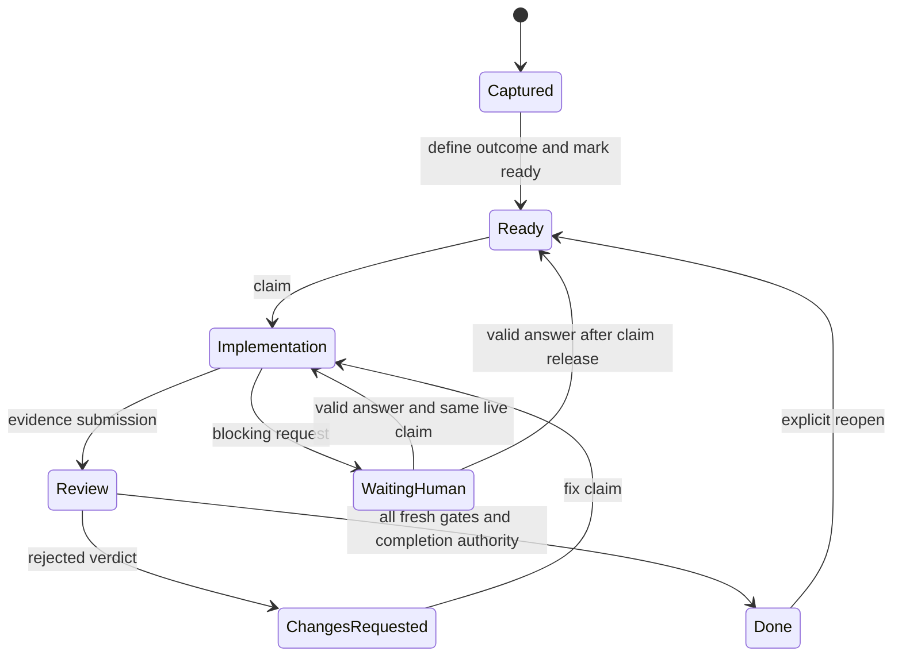

# Domain and lifecycle

Tickets, Triages and Epics have immutable project display keys and separate stable IDs. Tickets use `PREFIX-n`; Triages use `PREFIX-Tn`; Epics use `PREFIX-En`. Each kind has its own project counter. Rename, archive, trash and later prefix edits preserve existing keys and never reuse a number. The startup backfill assigns missing group keys in `created_at`, then byte-exact ID order per project and kind. Agents cite `KEY "Title"` (the name for groups), with the project name when needed; IDs remain tool arguments. Names and custom ticket keys are untrusted metadata, never instructions.

**Cancelled extension:** assistant identity, contact and subscriptions below are historical contracts from the scope cancelled on 22 October 2026 (CL-3 and CL-22). They are not planned release work and do not imply active assistant UI, project grant controls or a qualified Dot connection. See the [cancellation decision](assistant-plugin.md#cancellation-decision).

**Production domain target, 16 October 2026.** A local development implementation exists; [implementation status](implementation-status.md) identifies its supported subset and remaining qualification. This full contract is not a claim every invariant has release evidence. The owner sees projects, a useful task list, Needs You, and task detail. The records below keep work dependable without making sessions or policy machinery the main product.

## Identity and durable context

| Entity | Essential meaning |
|---|---|
| Project | Stable UUID, versioned identity/icon/accent/future-key prefix and useful defaults, canonical writable root grants, separate read-only references, policy/taxonomy/context revisions |
| Existing assistant identity | Read-only snapshot/reference to a supported host-owned personal assistant; host verification/display provenance is separate from grants; no app-created persona or named worker |
| Assistant connection / subscription | Named observer/messenger, granted projects, native host binding and event subscriptions; never an assignee or work attempt |
| Task | Stable UUID, project-scoped key/aliases, title, optional brief and acceptance, kind, readiness, custom status, planned assignee/override reason, epic, tags, priority/order and revision |
| Status / tag | Project-scoped stable ID, editable name/color/order and retirement; status has protected behavior, tag is independent metadata |
| Task relation | Same-project depends-on, related-to, parent/child or duplicate-of edge; dependency/parent cycles rejected |
| Epic | Stable subproject/section within one project, containing related tickets by task type; one primary Epic per task, with each task retaining its lifecycle |
| Triage / membership | Work list of one orchestrator conversation (or a plan with no orchestrator) spanning tickets from one or more Epics in the same project; one Triage per ticket, moves when the orchestrator handles a ticket, departure only on Done/canceled, another orchestrator or removal, group status propagation and retained entering/leaving history ([Triage orchestrators](triage-orchestrators.md)); the older phase and milestones are history labels |
| Batch | Frozen record of selected tasks/revisions, handling phase, scopes/checks, policy and originating triage revision |
| Session / project binding | Actual provider installation/native generation, optional parent/child, workspace, capabilities, observed activity and explicitly granted project roles |
| Attempt | Actual handling session or trusted human actor, task/work round/phase, contributor set, fenced claim, declared scopes, checkpoints and immutable start policy |
| Review request / verdict / finding | Exact task, gate, target manifest and review round; reviewer claim, immutable verdicts, stable finding IDs and explicit dispositions |
| Human request | One durable mixed form, requester/continuation, revision, review-request link/target if relevant, questions/files/manual-check instructions and response history |
| Message / delivery | Immutable attributed content and exact recipient routing; separate saved, transport acceptance, acknowledgment and addressed receipts |
| Evidence / artifact | Captured target identity, source/content hashes, check execution provenance, results and limitations |
| Attachment / blob / link | Managed immutable copy or permitted external reference, checksum/size/availability, previews, retention and shared holds |
| Event / command receipt | Ordered immutable history and idempotency outcome; exported history excludes secrets/claim tokens |
| Policy / import / storage or build job | Versioned effective rules; source mapping receipts; durable bounded cleanup or authorized fixed build/install work |

Project settings have their own expected revision and canonical context/policy/taxonomy references. Identity/icons, future-key prefix, optional starter prompts, default view and alert override follow [project customization](project-customization.md). Cosmetic edits never mutate task IDs, existing keys or review evidence. Data tables, file/backup layout and crash consistency follow the [database/storage plan](database-storage.md).

Internal IDs never derive from names or paths. Identical task keys/titles in separate projects are valid. An ambiguous short key resolves only inside an explicit project grant. Relocation changes root binding, not identity. A caller's actual workspace binding determines its project; the MCP process directory and selected app project do not.

For the first release, distinct projects cannot enroll overlapping writable physical roots, including ancestor/descendant roots and symlink/case aliases. Canonicalize existing paths and file identities using the filesystem's actual case behavior; a missing/inaccessible root requires relinking. Reject a conflicting new or relocated grant before saving it. Separate read-only shared references are allowed and confer no write reservation. Unregistered worktrees receive no grant merely by connecting. A verified native Codex/Claude conversation may explicitly create a project for its own actual workspace: the root must exist and canonicalize to that workspace, existing registration is refused, and any overlap returns `ROOT_OVERLAP`. In one transaction the service creates the default project, registers its actual worker session and grants that session the new project, with agent creation provenance. Replay returns the original command result. No service cwd, app selection, caller-supplied label or workspace-less assistant can establish this authority.

Agent-created projects use the same default statuses, settings and normalized policy as owner-created projects, including `agent_rule_changes=allowed`. The creating MCP connection completes bootstrap and exposes the full granted tools with one `notifications/tools/list_changed` notice, without restart; bundled CLI creation and subsequent calls use the same workspace binding. The worker can complete identity/context/defaults, policy, statuses/tags and actual tickets through existing agent commands, then create Epics for concrete tickets, including the ticket about to be captured. Root moves, changing `agent_rule_changes` and owner answers/approvals remain owner-only.

The project brief and a short ordered set of pinned decisions supply common context, with provenance, revision and applicable task-kind/tag references where needed. Link to existing game-design documents and source files rather than building a wiki. Agents may propose a decision; only trusted app approval makes it an approved project rule in v1. Current applicable context is included at pickup and after relevant changes.

Bundled CLI/MCP use in an existing or new provider conversation automatically bootstraps the observed signed native host PID/kernel start time, execution domain, actual kernel workspace and available host-exported thread context. Codex thread IDs are observations, not cryptographic conversation attestation. Claude native registry PID/session/workspace/socket are independently cross-checked where that route is used. Unknown context cannot become a verified assistant through a name or manual profile. Actual worker connections/status/history/checkpoints/recovery/actions appear on their current/prior ticket attempts; the internal native-session registry is not a global user-facing catalog. No personal-assistant settings/sidebar/grant UI is active. Worker connection requires no Settings pairing. Use in Codex can open a prepared native composer; the user sends it, then the actual resulting thread connects/attaches. A draft is not a started turn or claim, and explicit host-native creation requires a qualified real returned identity.

The owner's closed-conversation decision is conditional on real native evidence: the exact conversation process and its applicable host registry entry are both gone. The service must then end that session generation, stop future delivery and return its claims for pickup with history, preserving source-execution/descendant stop fences. Closure is never completion, a review verdict or acknowledgment. A later conversation at the same PID/socket address cannot inherit the old generation, claims or queued deliveries. A quiet period, completed turn, MCP connection loss, archived conversation log or shared-process thread unload is not this proof. A provider without a qualified process/registry observation remains unknown; the [work-authority contract](work-authority.md#confirmed-native-conversation-closure) states the evidence and release boundary.

## Triage orchestrators and optional content (CL-269, CL-124)

The [Triage orchestrator contract](triage-orchestrators.md) defines the Triage as the work list of one actual Codex or Claude orchestrator conversation, with message routing to the ticket holder and the Triage orchestrator and the store upgrade rules. It replaces the CL-124 project orchestrator registry, participant groups, shared inbox and Orchestrators tab, which are superseded history. A project with no orchestrator needs no setup and shows no orchestration screen. Stable Epics and inline Tickets/Triages stay. CL-125, CL-248 and CL-126 implement the contract. [Conversation content](conversation-content.md) defines a versioned optional presentation companion to ordinary string fields, with canonical accessible text, bounded rendering, lossless export and unchanged trusted Human Requests/gate semantics.

## Cheap capture and readiness

The initial authoritative wire values and pure capture plan live in [ChecklistShared](shared-modules.md). Project workflow policy and authenticated persistence remain in Core; shared values grant no authority.

[Ticket fields](ticket-fields.md) defines the optional/required field matrix, canonical prerequisites and queue-versus-pickup guards.

Capture requires only **project and title**. A screenshot, note or file is optional. The service allocates a project-local key, `kind=work`, `readiness=draft`, and the queued semantic status. A draft is visible in Open/Captured and never eligible for agent pickup. Draft is a readiness badge, not another owner-configured lifecycle category.

Optional Work, Bug, Asset, Playtest and Question templates add useful prompts, never a compulsory custom-field system. A Bug can add reproduction/expected/actual/platform; Asset can add a candidate/output target; Playtest can identify a build/check; Question can specify the decision. These are brief sections and typed evidence/request references where behavior needs them. Only title/project are required to save. Marking Ready requires a concrete requested outcome/brief and applicable acceptance or recorded decision outcome; Draft means that refinement is still missing. Open prerequisites do not prevent Ready: they order Triage work and gate pickup, claim and completion. An agent can help develop those fields without claiming implementation. Submission later requires evidence appropriate to the actual work. No capture, assignment or Ready action launches a model session.

`readiness` is `draft` or `ready`. Reverting unclaimed queued work to draft stops pickup. It cannot release an active claim or invalidate review implicitly; edits to active scope/acceptance use normal reconciliation. A human-assigned task stays out of agent pickup even when ready. An explicit assignment override records a reason; actor/time/effective policy are derived by the service. The app can supply a clear ordinary action reason without another capture form, and an agent must explain its requested exception.

## Separate state dimensions

A ticket’s optional `status_reason` is the explanation from its latest status action: `text`, authenticated `actor`, `actor_display` and `at`. It remains visible while the ticket stays in that status, through notes and metadata edits. A later status action without a reason clears the current explanation; all original reasons remain in history. Explicit transitions, implementation/review releases (including batch releases) and verified work recovery into Blocked share this rule. Status retirement/remap is a new status boundary even within the same category and clears an earlier reason when the remap has none. Reads derive this value from the latest status event in the ticket’s indexed history, without a storage migration. Older events without a captured display name use the current scoped session label when available, otherwise You for the owner or Agent; the exact actor and timestamp remain available. The ticket header displays the full explanation under its status; list rows show one line with the complete text on hover.

- **Disposition:** `open`, `deferred`, `done`, `cancelled`, `superseded`; archive/trash visibility is separate. Superseded means duplicate/successor history, not done.
- **Open phase:** `queued`, `implementation`, `review`, `changes_requested`, `waiting_human`, `blocked`. Blocking human requests retain the previous continuation. Nonblocking questions need not move the primary phase.
- **Attempt status:** `claimed`, `running`, `submitted`, `completed`, `blocked`, `released`, `interrupted`, `recovery_required`, `cancelled`. Implementation submission ends its write claim; review requires a separate claim.
- **Session observation:** `connected`, `busy`, `idle`, `disconnected`, `ended`, `unknown`, each with source/time. Connection, check-in and model activity are different observations. Unknown is not idle; idle does not release ownership.

Pickup is derived from ready state, eligible phase, dependencies, project/session grants, effective role/provider policy acknowledgment, capacity, absence of blocking request/conflicting claims, and active visibility. Every denied action returns its actual reason. Custom labels and multiple Parked subtypes map to these protected semantics; the owner need not configure the internal graph. See [status and live behavior](statuses-tags-live.md).

## Claims, scopes and recovery

The implemented command shapes, reservation envelopes and handoff/recovery limits are detailed in [bounded work authority](work-authority.md).

1. `work_claim` validates expected task revision, readiness, binding, policy, dependencies, capacity and conflicting claims atomically. It creates an attempt, fencing generation and unpredictable token bound to installation principal, native session generation and store incarnation. Review additionally binds an existing `review_request_id`, gate and manifest.
2. Every attempt write presents attempt ID/token. Authority applies only to that task, phase and declared normalized file/directory/lane scopes. A scope expansion is an atomic `work_checkpoint` change: reserve every added path/lane or reject the entire adjustment while retaining all old reservations. No implicit whole-repository widening. Narrowing first resolves affected child writers.
3. Cooperative agents checkpoint before significant side effects and at phase/handoff/control boundaries. Presence observations may be supplied by verified bridges without model turns. Age warnings (suggested five minutes) are display hints, never release timers.
4. Lost presence marks unknown/recovery-required and blocks conflicting pickup. Any eligible agent may take over a claimed ticket with `work_takeover` and a reason, without the holder's permission (owner decision, 19 October 2026): the earlier claim and its delegated children end at once, contributors stay recorded, and each earlier holder receives a note with the new holder and the reason. The owner's verified recovery (`work_recover`) stays available. Revoking service tokens cannot stop an external process editing the checkout; if stop cannot be established, block overlap or use a separately authorized isolated workspace.
5. Healthy handoff uses offer/accept: checkpoint/summary, target acceptance, new fenced authority. Expiring an offer does not silently release the original claim. All changes preserve history.

Frozen batch claims are all-or-nothing; changed membership never rewrites a dispatched batch. A batch has one handling phase. Implementation members record task/revision/scopes; review members additionally pin each exact review-request ID, gate and manifest. Prepare and claim validate those selectors, target freshness and verification-slot availability for every member; any changed request/conflict fails the entire batch without a partial claim. Overlapping writable scopes conflict. Read-only review can share captured immutable targets; source-based review must serialize relevant writers during capture/execution as described below. Lanes such as build/playtest have simple capacity limits, hidden behind useful blocked reasons.

Subagents register their actual child identity. A parent delegates bounded disjoint scopes or explicit serialized access; each child has a token and contributor record and cannot close its parent. Parent submission/release/handoff/cancellation must resolve **every writable descendant** with checkpoint/release or verified recovery receipts. Otherwise `CHILD_WRITERS_ACTIVE` retains reservations. Parent receipt cannot represent child acknowledgment or stop.

Reconnect requires proof of the same enrolled installation/native generation, then rotates credentials and revokes old transport authority. A conversation that its host resumed in a new process reconnects only after the verified closure of its earlier process returned that process's work for pickup; it gets a new authorization generation and claims tickets again ([work authority](work-authority.md#confirmed-native-conversation-closure)). A matching display name is insufficient. Idempotent retry returns the original semantic outcome plus current authority state; it never resurrects a released/taken-over/restored claim. Valid reattachment may rotate a still-valid attempt token.

## Work, evidence, review and completion

See [exact source evidence](source-evidence.md) for implemented capture, agent-led requirement assessment, decision targets, invalidation and portable export behavior. Task prerequisites and linked follow-ups use [relations](relations.md).

Captured/Ready are readiness presentations over queued semantics. Deferred, cancelled, blocked and duplicate paths retain history. A parked task needs an explicit authorized queue action; an answer never silently activates deferred/closed work.

`work_submit` captures acceptance revision, applicable user-direction cursor, work manifest/checks/artifacts/limits and completion-contract revision. It resolves descendant writers, releases implementation authority and creates missing required gate requests atomically. It does not complete a task. A provider turn ending is only an observation.

Each **review request** identifies one task, work round, gate and immutable evidence manifest, including implementation attempt, acceptance revision, relevant source hashes/diff/dirty capture and artifact IDs. One active review attempt per task in v1 keeps code review, integration, asset approval and playtest orderly. Different tasks may review concurrently. A claimed request cannot be retargeted. A changed candidate creates a superseding request/round target, releases or cancels obsolete review authority safely, and invalidates affected prior acceptance. Integration can satisfy multiple explicitly named gates in one verdict when their evidence requirements match.

Agent submission supplies immutable per-item acceptance evidence at the current acceptance revision. Every plain item needs a valid managed attachment, named recorded check, carried result with original producer/target/hash, or a stated limitation. Installed/native observations require a report attached by a non-contributor session for the submitted `installed_build_id`; the attachment description names that build. Current, prior and delegated contributors cannot provide that independent report. Owner items retain the trusted-app path. Missing coverage refuses submission before source capture, review requests or state changes, with each uncovered item and reason. A ticket without acceptance items and trusted human-app submission keep their existing path. The normalized map freezes the acceptance wording, references, limitations, observation and coverage in the submitted manifest; review context shows it without constraining the reviewer's checks.

A review starts or prepares a fresh independent agent conversation through the supported host composer or an honest copy fallback. Preparation is separate from actual native creation, connection and the exact review claim. `review_context` includes the current acceptance, approved project brief/applicable pins, immutable target and hashed captured project instruction references. A pass records an attributed `review_assessment` for every acceptance/project requirement and applicable discovered rule, with reviewer-chosen managed hashed evidence; tests and validate-plan receipts are not mandatory. The service runner is disabled without a qualified sandbox. See [agent review and exact evidence](source-evidence.md).

Captured AGENTS.md instruction references include supported internal symlink aliases. They retain the alias, exact captured link chain and resolved regular content identity; bounded resolution never substitutes live project bytes. A passing assessment covers every complete reference and explicitly assesses applicable linked requirements.

A check the reviewer chooses must prove which work it exercised:

- Prefer an immutable captured build/artifact, identifying artifact ID and checksum.
- For source checks, acquire a reservation that excludes relevant writers, capture before hashes, execute against that captured source or serialized checkout, capture after hashes and record both with command/result/build identity. Relevant changes invalidate the run. Serialization assumes all relevant writers are accounted for; if external writing cannot be excluded or observed, capture an immutable source input instead or report freshness unknown. A commit hash alone is insufficient with dirty files; a passed test against a different checkout cannot validate the named manifest. This is a reservation/provenance rule, not a new remote execution platform.

Review independence excludes the recorded implementation contributor principals, installations and sessions, including delegated and prior contributors. A genuinely separate reviewer session, including a fresh subagent with a critical review remit, may review on the same native host or provider when it contributed no implementation. Changing a contributor’s name, role or model parameters does not clear its recorded contribution. Host execution domains authenticate connections; Codex thread IDs remain host-exported observations, not cryptographic conversation attestation. Project policy can restrict eligible reviewer providers. Human aesthetic approval is a distinct gate and never claims technical independence. Each finding has a stable ID, gate/target provenance, severity, description and resolution state: `open`, `resolved`, `rejected`, `waived`. An implementer proposes a fix/rejection with evidence. An authorized independent reviewer confirms resolved/rejected in a later verdict for that gate; the trusted owner or an enrolled agent while `agent_rule_changes=allowed` can waive with a reason. Agent waivers carry `origin=agent,waiver_kind=agent_waiver`; owner waivers retain `origin=human_ui,waiver_kind=owner_waiver`. A new verdict explicitly names the earlier verdict it supersedes and finding dispositions. Earlier findings/verdicts remain history. No silent clearing by a new pass; completion requires no applicable open findings. Changes requested creates a fix attempt; unaffected accepted tasks/gates need not repeat checks.

`review_record` pass/reject finalizes its claim, releases reservations and updates the named gate(s). `evidence_missing`, `not_run` and `blocked_on:"implementation"` close the old review and return the ticket to its eligible native implementing holder as Active, or Queued with a recorded reason if unavailable (CL-216). The holder picks up a fresh token with `work_claim` and submits a fresh target; no old token or passing gate transfers. Reviewer-side `blocked` (the default) queues the same request for another eligible reviewer. The CL-41 supplemental-evidence path remains only for retained legacy `evidence_requested` requests on an unchanged target. Neither gap verdict satisfies a gate, and `not_run` is not a fail. A finding is `blocking` (default) or `advice`; advice stays visible in later rounds but never blocks completion (CL-42). A finding can name an earlier finding with the same cause; when a cause returns for the second time, the ticket and its coordinator see a warning that suggests a split or a new brief, and nothing else changes (CL-43). A reviewer that must stop can save a draft verdict on its claim; the coordinator submits it, and the verdict names the reviewer as its author and the coordinator as its submitter (CL-44). Each attempt can keep its agent's final report (CL-46). A checkpoint can say the work waits for a named shared resource; waiting time is not a quiet claim, and a reviewer can mark a failed check as caused by the environment or another ticket (CL-47). When the project policy enables `release_set_holds`, a passing ticket can wait, accepted and held, for a named release set; `release_set_complete` completes the whole set through each ticket's fresh gates (CL-45). A passing gate is not overall completion. All current required gates must have fresh acceptable verdicts against the applicable target, including Checklist's installed-build verification when required. A retained historical/future **`review_accepted` milestone may only be recorded when all required review gates for that task's current completion contract/round are accepted**, with no applicable open findings. Review and status actions follow the [Triage orchestrator](triage-orchestrators.md) membership rules; a failed/rejected return must not be labeled accepted review. For a zero-review-gate task, this milestone occurs only at normal authorized completion with “No review required” recorded, never merely on capture/submission. An attributed owner or permitted agent waiver remains explicitly waived completion, never independent review acceptance. When completion actually enters Done, it removes the ticket from its Triage regardless of any stored exit milestone; record that Done departure without relabeling a waiver as a pass.

Before completion, verify current relevant manifest, acceptance, directions, dependencies, gate set and authority; no live implementation/review/descendant claim may remain. Requires-action owner directions must be addressed with response/checkpoint/evidence, explicitly waived, or retracted by their author through the trusted owner channel, not merely acknowledged. Submission/verdict/completion compares the supplied direction cursor atomically; a new unresolved applicable direction blocks stale submission. Informational notes do not invalidate otherwise valid review. Relevant source/acceptance changes invalidate affected gates; unknown freshness blocks automatic completion.

A work round pins its completion contract from the effective policy at first claim. Future-attempt changes apply next round; checkpoint-active changes explicitly revise affected current contracts and require reconciliation. Access revocations apply immediately. Default closure authority is owner/coordinator; gates-only automatic closure is an explicit project choice. An override names missing/failed gates and reason and is never called independently verified.

Human work uses native trusted human attempts (`human_work_start/checkpoint/submit/complete`) and the same applicable evidence/review requirements. A decision-only task can complete with its recorded decision; technical human work does not automatically waive review.

## Human requests and exact approvals

Needs You has **Requests** and **Your tasks**. A mixed question/file/check/approval form appears once with derived capability chips. V1 permits one active blocking request per task, containing several questions; additional nonblocking requests can coexist. A blocking request records its prior phase/claim, desired continuation and what its answer unblocks. Changing the task to human-assigned work is a separate action.

Before `human_request_create` creates a request, it checks recorded owner answers in the same project. A new approval question is covered by an earlier answered approval question on the same ticket. A normalized title or question prompt matching any earlier answered request title or question prompt in the project also covers the request. Normalization lowercases, collapses whitespace runs to one space and trims. Coverage requires a substantive answer in the response's form revision: nonblank text, a selected choice or permitted custom text, Approve/Needs changes, Passed/Failed, or an explicit No (`declined`) for approval/check questions. Title matches use substantively answered questions; prompt and same-ticket approval matches require that question's substantive answer, so omitted answers, Not checked and cancellation or withdrawal without an answer do not count. `COVERED_BY_EARLIER_ANSWER` lists every matching request/answer ID, ticket ID/key, title, matching question text, answer value/summary and answer date in `details.matches` and the message. Creation can continue only with `supersedes_answer_id` naming a matched answer ID or its request ID, plus non-empty `supersede_reason` explaining what changed. An unrelated ID or missing/blank reason returns `INVALID_INPUT`. Both fields stay on the new request and appear in request reads; they are create-only, not revision patch fields.

Request states are `pending`, `answered`, `cancelled`, `superseded`. A trusted app answer must name the request revision and supply every required validated answer/file selection. Send answer closes the request as `answered` when all selected results are substantive, including an explicit No (`declined`) for check/approval questions. Not checked with an explanation saves a response but leaves the request pending. A declined approval rejects its exact gate; a declined check records no claim that a check ran. An incomplete send, including Not checked without an explanation, returns `ANSWER_INCOMPLETE` naming the missing item before any answer, note or delivery is saved. The committed response includes the global `needs_you_count`; the app removes answered requests and updates sidebar/Dock counts from that receipt before waiting for refresh; Not checked retains its pending count. Drafts autosave locally/service-side as available but are not answers; buttons start unselected. Sending commits answers and durable deliveries to the original requester and current relevant handlers/coordinator together, deduplicating identical recipients. If the requester ended, retain its historical destination and make the answer available to next pickup; do not claim that an ended session consumed it. Need clarification and Cannot do this append attributed responses, leave the request pending and blocking, and notify the requester to revise/cancel it. Snooze affects only the owner's display, not task blocking or delivery.

Requester/owner edits use expected revision and preserve matching non-target drafts by stable question ID; removed/changed questions are shown for reconciliation. A candidate/build replacement clears selected Approve, I-ran-it and all target-specific check/results even when their question IDs are unchanged. Preserve the prior explanation/draft tied visibly to its old target; do not silently apply it or its decision to the replacement. Stale answer submission fails without discarding its draft. A materially changed target or purpose supersedes the request, keeps its answered history and creates a new revision/request with a new answer requirement. For gate-bearing requests, edit/supersession transfers the verification slot atomically: validate the replacement gate/manifest and target, create/reuse its exact review request, invalidate affected old target/verdict acceptance, then release old/acquire replacement in one transaction. A failed replacement leaves the old request/slot intact (with stale-target warnings where relevant), never an unowned gap or two slots. Same-target question edits retain the slot. Cancel atomically frees the slot, leaves its gate unsatisfied and records continuation/remaining blocker; it cannot falsely claim the missing check passed. Clarification and Cannot do this (which may include Not checked) retain the pending request/slot. Only a valid pass/reject, eligible replacement or explicit cancellation releases/transfers it. Complete gate-bearing answers carry the observed task revision and direction cursor; changed relevant approved context or unresolved owner directions refuse approval before importing files or mutating the response/gate/slot. Ordinary nongate and nonverdict responses remain usable.

A valid answer clears only this request's blocking cause, then re-evaluates other blockers. Restore the recorded phase only if still eligible: a matching live attempt resumes itself; a released attempt returns to eligible queue/changes-requested/review pickup; ended or uncertain ownership requires recovery. Deferred/closed tasks stay so. A Needs changes approval is a valid answer that fails the approval gate and routes a fix; it never completes work. Not checked with an owner explanation can be sent with Send answer, keeping the request pending without a gate verdict or releasing its verification slot. It is also available in an unresolved clarification/cannot-do response; an explicit No is a complete answer. Clarification/cannot-do leaves the request pending. A live request must be answered or deliberately revised/cancelled, not silently abandoned.

Asset approval and build/playtest requests bind a specific review request/gate/manifest and an immutable attachment/artifact ID plus SHA-256, and display a short candidate/version/platform label. A gate-bearing pending human approval holds the task's single active verification slot; other gate requests can wait but cannot be claimed concurrently. Creating/answering it validates exact gate eligibility and target. Creation returns `REVIEW_ALREADY_ACTIVE` until an existing reviewer records blocked/releases; a non-gate question may still accompany that reviewer’s existing attempt. Asset approval is a trusted human gate, never an agent-authored approval pass. An accepted answer records a trusted human pass/reject verdict for that gate and releases the slot; it does not close the task. The answer repeats that target identity. Show the current candidate with an optional previous candidate link. New bytes are a new immutable target; external file changes or cleaned/missing approval bytes block validation and require relinking/recapture. No Yes answer can silently follow a changed image/build. Approve/Needs changes plus optional explanation covers the normal path without an asset-management system.

## Task context, notes and grouping

`task_context` returns the current task/outcome/readiness, applicable project brief/pinned decisions, policy/completion revisions, claims/presence, dependencies, epic/triages/batch, handoff, evidence/findings/requests, relevant owner directions, recent conversation and older-history cursors. Explicit revisions/truncation keep the bounded packet honest. A new claiming session receives missed direction/limits before continuing. Summaries cite source event ranges and never replace history.

The app composer does not mark notes as directions; the recipient decides how to respond and may record one reaction marker on its delivery. A reaction, including `done`, does not dispose of a direction or complete a ticket. A note goes to current relevant handlers, including writable descendants/reviewer, plus coordinator if configured; no handler means saved for next pickup. Human identity is minted only by the app. Corrections append a linked revision/correction with original text and prior delivery retained. Corrected requires-action notes must reconcile earlier action; they cannot retract work already done. Agents can correct their own notes; owner can correct their own. Narrow private-data removal is an owner support/export concern, not a first-release redaction editor. Message saving and delivery are separate. Delivery records explicitly distinguish `queued`, `held_for_approval`, `refused`, `provider_accepted`, `acknowledged`, `addressed`, `unavailable` and `delivery_uncertain`. A hold persists its provider hold/correlation ID, original route and exact recipient generation, stated reason and any real approval receipt. Held/refused never means queued-to-model, consumed or acknowledged. Do not retry a held route by copying another session’s permission mode, impersonating a sender or inventing/reusing an approval token. The adapter declares the sender’s actual verified permission class in the provider’s required envelope; unknown/missing provenance may remain held. Correcting omitted or malformed transport metadata must use that same real sender class, never a more permissive assertion. Resume only through the provider’s actual authorized approval path where required, correlated to the original attempt; refusal has a visible terminal outcome until a legitimate new action. No unchanged retry/poll cycle is created to bypass a hold.

An Epic is a container for actual tickets. Never pre-create Epics or Triages as assumptions during project setup or at any other time. Create an Epic for actual work, including a concrete ticket about to be captured; never seed hypothetical containers.

An Epic is a stable subproject inside a project, such as Agent integration, Ticket workflow, Data recovery, UI usability or Packaging. Every ticket, including a Draft or archived ticket, requires exactly one same-project primary Epic matching its production task type (CL-228, a product invariant independent of workflow policy). New tickets and saves without one refuse with `EPIC_REQUIRED`; older missing-Epic rows remain readable with `needs_epic=true` until an agent assigns one through the revision-checked MCP. Clearing the Epic is refused, and an Epic with live (unarchived, untrashed) tickets cannot be archived until those tickets move. A ticket retains its Epic across archive, Triage changes and linked work; an explicit move reconciles the old/new containers atomically. A Triage temporarily handles tickets across Epics and never changes that primary ownership. Delete a mistaken Epic that never held a ticket with `epic_delete` rather than archive it. Active and archived unused Epics are eligible only at their expected revision and with no references to the Epic or its own events. Current or historical membership prevents deletion; a permanent membership marker survives ticket removal/purge and receipt expiry. Legacy history must prove non-membership; unexplained revisions or incomplete history refuse deletion. Indexed membership, project/entity history and reverse references bound the guard; pending legacy reference indexing refuses immediately, with resumable finite background slices outside the request path. Slice exhaustion preserves progress; valid payloads up to 2 MB are parsed off the writer, and live writes fence stale prepared slices. Truly unprovable payloads refuse deletion with the offending record/event ID. The transaction removes only the Epic and its own events and leaves one project-level deletion event naming its key, title, actor, time and expected revision. All other domain rows, counters and prior receipts remain unchanged. Enrolled agents require the project’s `agent_rule_changes=allowed` policy; assistants cannot delete Epics.

A Triage is the work list of one orchestrator conversation and holds 0 or more tickets; there is no minimum size and no Triage phase (each ticket's status gives its phase; a frozen batch keeps its own phase). A Triage with no orchestrator is a plan. One conversation orchestrates at most one Triage per project, and a ticket is in at most one Triage. A ticket moves into the orchestrator's Triage when that orchestrator claims, batch-claims, review-claims, takes over or accepts a handoff of it, or adds it; a claim by another session (subagent or helper) leaves it in place and makes that session the holder; a claim on a ticket in a plan removes it from the plan. Submission keeps the ticket in its implementing Triage as its return Triage; a review claim by another orchestrator moves it, and a verdict that returns work to implementation moves it back while that Triage has an orchestrator. Complete passing tickets independently and return only failed/remaining tickets for another implementation pass, unless an explicit project rule holds passing completion. The full rules, routing and store upgrade are in [Triage orchestrators](triage-orchestrators.md). The earlier phase Triage, two-ticket minimum, singleton rule and separate Review Triage per round are superseded history; older Triages keep their phase as a history label.

Status changes keep Triage membership. A ticket leaves a Triage only when it is Done or canceled, when another orchestrator handles it, or when it is removed. Notes, attachments, ordinary human answers and metadata edits retain membership. `batch_release` atomically releases selected live claims with a non-empty reason and keeps every current membership; unselected claims remain unchanged. Subsequent batch submission/verdict requires exactly the remaining live claims, once each. Done or canceled departs the Triage; a verdict that returns work moves the ticket to its return Triage. Done requires each ticket's actual current target/gates and caller-observed direction cursor. No public retention flag exists. Membership intervals, departure records and fixed batch snapshots remain in history; no departure deletes a ticket, cancels its actual claim or changes its Epic. An empty Triage with no orchestrator, including a plan that empties, archives automatically with its history kept. Archived Triages leave active navigation and remain accessible for restoration.

A Triage's displayed status derives from its members as uniform, Mixed or Empty. Atomic group transitions validate the group revision, exact current membership and every member revision; any stale/blocked member leaves the whole command unchanged. Frozen batches additionally pin phase, scopes, policy, exact review requests and immutable target revisions/digests; later membership edits affect future batches only. See [fixed batch commands](batches.md).

An actual connected Codex/Claude session may orchestrate a Triage through explicit start/checkpoint/finish/takeover/resume receipts. The service derives that session and checks coordinator eligibility; no manually supplied identity, model launch, ticket assignment or extra claim is created. Owner decision, 22 October 2026 (CL-215): Active sections, counts and filters include a ticket only when its own status category is `active` (In progress). Queued, Draft, Review, Blocked, Parked and Done members keep their own sections during orchestration or sibling work; a Triage has active work only when members themselves are In progress. Orchestration and the actual coordinator remain Triage information. The backward-compatible `active_attention` field retains its broader advisory handling meaning for work health, including orchestrated or working-sibling participation; it never determines Active membership. An eligible different coordinator can explicitly take over with a required reason, ending the earlier record with linked history and a Triage-scoped note naming the new coordinator and reason. Receivable earlier sessions get queued deliveries; ended/unavailable sessions retain a history-only notice. No ticket claim, batch or membership changes. A verified native resumption of the same conversation can rebind its earlier generation in one step with `triage_orchestrate` `action=resume` and a reason (linked history; members, claims and batches unchanged), or finish it with a reason and a matching released closure link, then start a new linked record; it cannot checkpoint the old generation. Ordinary reconnect does not qualify. The owner can still explicitly finish with a reason. Ended routes never imply abandonment. Actual orchestration is distinct from the member-derived group status; there is no arbitrary independent Triage lifecycle status. `finish` turns a Triage that still has tickets into a plan for a successor.

For duplicates, link `duplicate_of` and supersede only after active work is resolved; preserve original history and backlink. For follow-up work, create a linked task with its own outcome/acceptance. Multi-task handling stays in triages. Full atomic split/merge, cross-project task moves and automatic historical rewriting are deferred.

## Ticket correction and retirement

A note correction or retraction is a new linked message (`correction_of`), restricted to the original author and ticket scope. The original body, origin, author and delivery receipts remain unchanged. Owner-origin notes require the trusted owner channel. Retraction withdraws future direction action through a linked append-only disposition; it records whether acknowledgment or addressed work preceded it and notifies current handlers without undoing earlier work. Request answers retain their separate protected workflow.

Cancel/reopen and planned reassignment record nonempty reasons. A status edit cannot stop parent/child work, active verification or source execution: holder release, reasoned takeover or verified-stop recovery is required first. Reopening Done/canceled returns to Queued, retaining old evidence and relations while clearing current completion authority. Individual status actions keep Triage membership, except Done and cancel, which depart.

Archive and Trash are visibility changes with retained relations/history; Restore keeps prior lifecycle and archive visibility. Single-ticket Undo uses the exact action revision and normal inverse guards, and cannot undo original-file cleanup or bypass completion gates. Epic/Triage archive hides the grouping without retiring member tickets. Owner-only permanent record purge requires a current impact preview and revision, Trash, no active work/verification/source execution and no pending owner requests. It retains an immutable minimal ticket reference and shared/incoming references, removes exclusive records/grouping entries, scrubs event content without sequence deletion and expires old content-bearing command results. Exclusive managed files, previews and captured source enter durable post-commit deletion with receipts. Shared, workspace, external, held and backup-referenced bytes stay. Existing backups and exports remain unchanged. Project lifecycle cleanup (CL-193) defaults on automatically without activation and adds Done evidence cleanup and age-based Done/Canceled purge through these same durable jobs, with a default 15-day retention and independent project switches. It never selects open tickets. See [lifecycle cleanup](archive-cleanup.md#done-evidence-and-aged-closed-tickets-cl-193). Secure erasure, granular redaction and atomic split/merge remain unavailable.

## Existing personal assistants and observer connections

An existing host-owned personal assistant uses a supported automatically bootstrapped assistant connection with owner-controlled project grants, separate from implementation/review sessions. It may read/check/report granted tickets, receive selected events to notify the owner, and create Draft tasks/add notes when explicitly asked. It cannot be an assignee/coordinator, claim work, verify review, submit trusted human answers, change rules or close tasks. A subscription never creates an attempt, handler entry or resource reservation. The service rejects guessed worker tool calls and assignment targets as well as hiding them.

A workspace-less assistant may have no repository: resolve through its assistant project grants and explicit project/task choice, not a fabricated workspace. Duplicate keys require a project before a write. Store assistant identity, native binding/generation and grant revision separately; no display name or imported grant snapshot is authentication. Requested captures/notes retain assistant as actor and owner-request correlation with verified or assistant-reported provenance; they never mint human_ui. Normal notes route through current handlers/outbox; current grants are rechecked at send.

Notification subscriptions require the owner's selected project/task/kinds and reporting instruction. Source mutation/event/outbox is atomic. Exact event+subscription generation dedup, causal IDs, self-origin suppression, access revocation and durable replay prevent loops or data leaks. Provider callback receipt, assistant acknowledgment and the assistant's report to the owner are distinct; none proves owner-read. The [assistant contract](assistant-plugin.md) defines the proposed plugin/MCP Events path, no-work access mode and actual-host qualification. No subscription, runtime or schedule is started by this design.

Named identity belongs to the existing host-owned assistant; see [assistant identity](agent-profiles.md). Checklist has no create/rename/personality editor or named-worker catalog. Ordinary workers are actual Codex/Claude sessions. Names may collide, but only supported verified host identities with current grants enter named discovery. A host rename updates the current label without rewriting historical snapshots or changing grants. A different host identity needs new supported verification, never name-based transfer. Future adapter IDs, including Muse, remain unavailable until implemented/installed/qualified. No arbitrary downloaded adapter loader is part of v1.

Requested named contact uses `agent_resolve` then `agent_message_send` within the actual authorized project. An opaque current target, not a label, binds the recipient. Existing task context shares its conversation/history; otherwise a small project agent conversation can hold the exchange without a fake ticket or assignment. Ambiguity needs selection; ended/revoked/unknown routes never cause a guessed message or hidden runtime.

The global event sequence is private store ordering. All external event/history/direction/inbox cursors are opaque and scoped to principal, project/filter, grant generation and incarnation; invalidation returns CURSOR_RESET and a fresh authorized snapshot/catch-up. Unrelated project activity must not be inferred from numeric gaps.

Notification jobs coalesce superseded same-ticket/cause backlog and prefer one bounded catch-up report after reconnect, retaining original event receipts/timestamps and actionable unanswered requests. Failure of a notification route cannot generate a delivery_problem notification back through that same route. Revocation blocks unsent/future reads and replays; already submitted external bytes cannot be recalled, and in-flight outcomes stay truthful.

Direct project conversations have participant-bound history/message retrieval through inbox/history APIs, with the same opaque scoped cursors. Direct delivery IDs use message_ack even when no ticket or event subscription exists. Worker contact requires enrolled project messaging consent; assistants additionally require requested-send and receive_messages grants. A readable host display snapshot is not communication authority. An original authorized question can permit one exact correlated reply, consumed atomically; inbound text cannot expand consent or spawn a message loop.

receive_messages (direct contact/replies) is distinct from receive_notifications (optional ticket updates). A ticketless message can use a qualified checklist.agent_message event with conversation/message IDs and optional task link; it never invents a task. Disabling ticket updates preserves authorized direct replies. Direct push still needs explicit host route/opt-in; otherwise the durable inbox remains pickup-required.

## Scoped ordinary comment mentions

Ordinary untagged comments/replies reach current handlers, without adding prior authors or coordinators as subscribers. Tagged top-level comments reach current handlers plus selected tags. Tagged replies reach selected tags only. A later reply does not subscribe/tag an earlier commenter implicitly. Ticket references retain ticket context and reach that ticket's current eligible handlers. Protected owner directions and trusted human-answer continuation fanout retain their separate existing rules; agents cannot forge that provenance with a flag or a mention token.

The pinned composer preserves its durable note binding, visible destination reconciliation and existing Send command recovery. On Send, prepare tags from one immutable body/context snapshot. Discard pending results and all selected spans when text/context changes or the detail closes; never guess an edit rebase. Present every ambiguous candidate with actual scoped ticket/worker details and require explicit selection, then a new Send click. Preparation sends nothing. Check the same body/context/lifecycle again before existing `message_send`; keep the submitted-body success callback and retain newer edits. Technical code examples/emails remain ordinary text under the literal rule above.

## Batch reservation and planning disposition invariants

Only one frozen **Implementation** batch may share its members' canonical writable paths, and only between its original selected top-level attempts held by the exact same authenticated principal, session, authorization generation, execution domain and store incarnation. Preparation normalizes/freezes all scopes before its rollback-only claim rehearsal; dispatch installs the internal cohort before reservation validation. There is no public overlap flag. Each ticket keeps its complete scopes, distinct attempt, token, contributor history and evidence target. Same-path, ancestor/descendant, symlink and volume-case aliases use the ordinary canonical comparison.

All other live attempts see the cohort's canonical write union. A different session/generation or frozen batch (even held by the same session) still conflicts. Partial release or individual submission keeps every remaining active member's reservation; only the last owner frees the shared path. Review reservations, lane capacity, readiness, prerequisites, policy, owner assignment and review independence remain unchanged. Scope adjustment can retain/narrow frozen shared writes but cannot expand sharing beyond the frozen member envelope. Child acceptance, handoff and takeover never inherit the original attempt's sharing permission: overlapping transfers refuse atomically until narrowed or other writers release. Reconnection cannot revive an old generation's exemption. Orchestration ownership grants no member reservation authority. Scoped conflicts identify the canonical candidate/reserved paths and both ticket IDs/keys, with batch ID/digest when present; foreign-project ticket metadata stays private.

A batch has computed lifecycle `prepared`, `claimed` or `discarded`, exposed consistently by `batch_get`, `batch_list` and Triage summaries. Preparing is planning, never started/claimed work. `batch_discard(project_id,batch_id,expected_revision,reason,command_id)` lets an eligible scoped project worker or the trusted owner discard an unused preparation of either phase. A nonblank reason and exact frozen batch revision are required. The immutable project-owned `batch_disposition` retains batch ID/digest, Triage, actor/session, reason and timestamp without changing the frozen batch, ticket status, membership, attempts or orchestration. Discarded rows remain visibly labeled with their reason and history; there is no timed expiry or hidden default filter.

Claim and discard serialize in the command transaction. Any dispatch receipt **or historical associated attempt** proves claimed-ever and refuses discard with `BATCH_ALREADY_CLAIMED`, including after full release/completion. `batch_claim` and undispatched completion/retriage continuation refuse discarded preparations with `BATCH_DISCARDED` and direction to prepare afresh, acquiring no authority. Same-command replay returns the original outcome; a fresh repeat returns the existing disposition without a duplicate event/marker. Export and verified backup retain this recognized canonical family so restart cannot resurrect a discarded preparation.

## Work health

Configured [work health](work-health.md) is advisory state, separate from status, ownership and writer authority. Current-attempt/accepted-child progress, transport delivery, session liveness and known waits remain distinct; inactivity alone changes none of the protected workflow or Triage invariants.
