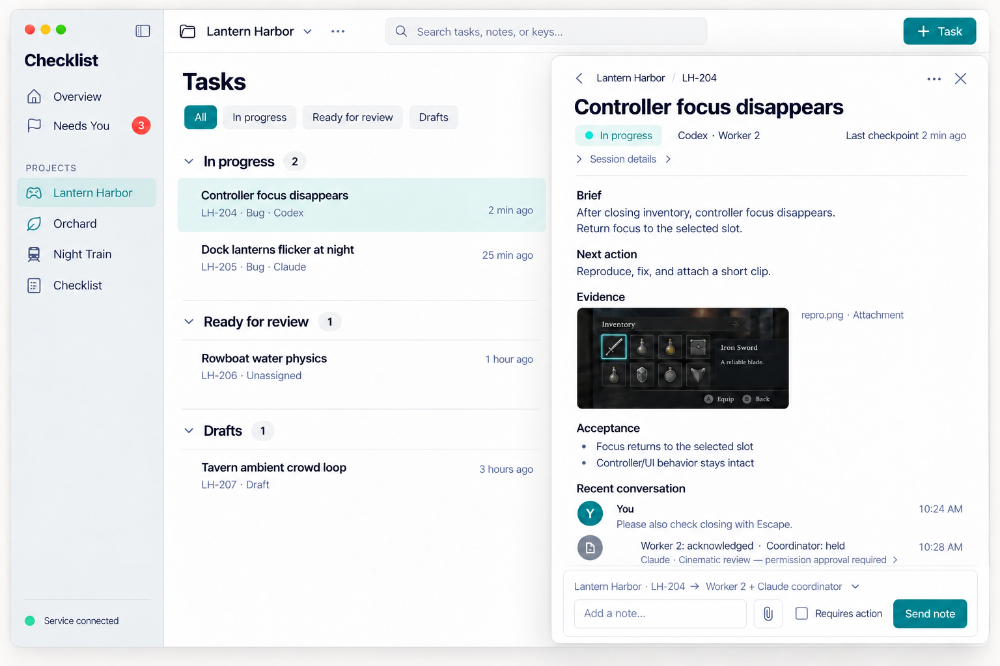
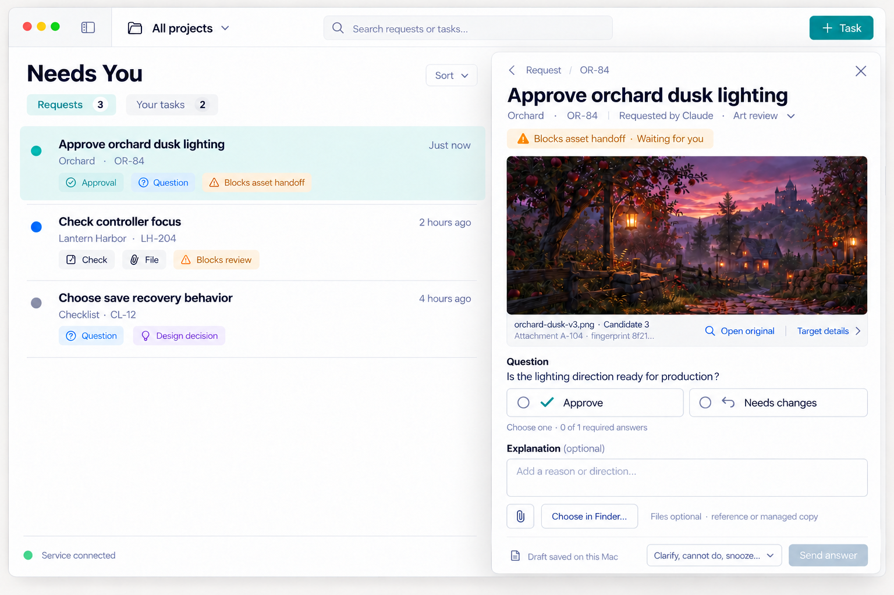

# Interface and interaction specification

Show each Triage and Epic key beside its name in list rows, detail overlays, membership/filter pickers and Past Triages. Include the key in the accessible text. A defensive record without a key shows only its name. Search matches the group key as well as its name and purpose. Keys remain display labels; actions keep the stable record ID and revision.

The local development app implements the primary task/request overlays and sidebar. This specification includes remaining target behavior; [implementation status](implementation-status.md) distinguishes shipped source from release qualification. All tickets in concepts are synthetic. The primary workflows are capture, handle/review, answer, and inspect game/app artifacts.

## Glossary

Each visible concept has one name in every label, button, menu, sheet and help text. `GlossaryTests` scans every string literal in the app, including literals inside `\( )` interpolations, for the retired names.

| Term | Meaning | Do not use |
|---|---|---|
| Ticket | One unit of work in a project, with a key such as CL-51. | task |
| Ticket type | Work, Bug, Asset, Playtest or Question; capture offers it as a starter. | task kind |
| Epic | A stable group of related tickets in a project. A ticket has at most one Epic. | subproject |
| Triage | A temporary group of two or more tickets handled together in one phase. | handling pass, handling group, handling set, handling triage |
| Phase | The handling step of a Triage: Implementation or Review. | handling phase |
| Note | A message on a ticket from the owner or an agent. | comment (in the app) |
| Request | A question, file, check or approval that an agent asks the owner to answer; it appears in Needs You. | |
| Draft | A ticket whose brief still needs refinement. Unsent text in a form is "Saved on this Mac, not sent". | |
| Start my work | The owner starts a ticket that is assigned to them. | Start my task |
| canceled | The only spelling, in code and in the app. Older records may contain the stored value "cancelled"; the app (`Canceled`) and the service (`LegacyStoredValue`) each read it through one named constant. | cancelled |

Write "Epic" and "Triage" with a capital letter, also inside sentences ("New Triage", "Archive Triage").

## Navigation and layout

Use a native resizable window with a sliding/toggleable **left sidebar** and **right slide-in detail overlay**. The main list occupies all remaining content underneath the overlay. Never allocate a fixed third column. The nonmodal overlay begins below the toolbar, has a restrained shadow, Close and Back controls, and leaves the list usable. At narrow widths it may cover the content; it still preserves the underlying list. Target comfortable use at 1100×740, full operation at 900×650, and keyboard/large-text checks at both sizes.

The sidebar contains Overview, Needs You with an actionable count, and project names. A project opens its **Tickets** tab directly; the other project tab is **Epics**. Capture remains available from Needs You; All projects capture requires choosing a project. Epics shows the project's Epics. Inside Tickets, temporary Triages appear as expandable Triage rows that list their member tickets across Epics. They have no separate tab, workspace or sidebar navigation item. Rules, Activity, archived/trash views and storage stay in the project menu/settings; daily navigation is not an admin console. The toolbar always retains the sidebar toggle even when hidden, current project/menu, Search and + Ticket. View menu and Control-Command-S toggle it, with remembered visibility/width and reduced-motion support.

Overview answers what needs the owner today. A compact **Working now** strip lists active attempts (agent session, ticket key, last checkpoint age; a click opens the ticket); ended, revoked or unknown sessions show as recovery needed, never as working. Groups follow by need: owner requests, ready for review, ready for pickup, active work, recovery or blocked, stale checkpoints (no checkpoint for 30 minutes; a resource wait is not stale) and done today. Each group shows its exact count, its first five rows and Show all (owner requests open Needs You; other groups page in place). Below them, the latest three review results per project (verdict, ticket, reviewer, time; Show more projects pages on when one page cannot hold every project) and a digest of tickets completed since the owner's previous visit, one line each, with Show all when it has more than twenty and Clear once every line is shown; each new visit starts from the previous one, and the digest stays in the app and sends nothing. Every Overview section distinguishes loading, failed, offline and empty, and says when a refresh failed while it still shows the last loaded rows. Ready for pickup and ready for review leave out tickets that wait for a blocking owner request, an open prerequisite, active work or an owner check. Groups update live and never move the open ticket. Counts lead to their rows; avoid metric tiles. The Dock icon shows the Needs You count, clears at zero, and Settings can turn it off. macOS draws the badge only when Checklist may badge its icon, so Checklist asks macOS for that permission by itself the first time a window opens (owner direction, 20 October 2026). macOS shows that prompt once per app, so it covers badges and alerts; desktop alerts still stay off in Checklist until the owner turns them on. If the owner declined, Settings says how to allow it in System Settings. Needs You has two views, **Requests** and **Your tickets**. An agent asking one question does not assign the entire ticket to the owner. Global rows and overlays always name the project. Custom icons/accent reinforce that name rather than replace it; a missing image falls back to a built-in symbol.

Open a related ticket, request, session or Triage in the same overlay with a breadcrumb/back stack. Preserve each item's scroll, draft and focus; Back restores the prior item. Escape first leaves the editor preserving its draft, then dismisses the overlay and returns focus to its origin. Switching projects never silently moves a draft to another ticket. Persist selection, filters and window state. If the initial scoped read cannot connect after a store replacement, confirm the saved project against the service’s complete project catalog, including archived projects. Only a confirmed missing project clears the saved scope to All projects; Media review returns to Tickets. Failed or canceled catalog reads preserve the selection and drafts. A genuine current catalog failure records its concrete Last error and the normal offline state; cancellation and superseded results leave service health untouched. A deep link reopens the same scoped entity, subject to access and availability.

Close and Back have a full hit target of at least 28×28 points and a visible hover background. Back is disabled when there is no earlier detail. Clicking empty space outside the nonmodal overlay dismisses it and returns focus to the opening control. Clicking another ticket opens that ticket; other controls keep their normal actions and focus. Outside-click handling never consumes the underlying click or clears note, answer or edit drafts.

The current app has one main workspace window backed by one shared navigation and command store; separate workspace windows are not exposed until their draft and command ownership is qualified. App Settings opens as a large attached modal over the invoking main window from the app menu, Command-comma or sidebar gear. General and Storage share that same window-local modal; no separate Settings scene remains. Close, Escape or an outside click dismisses it and restores the invoker without changing the underlying screen. The dimmed background is inactive and the dismissing click is consumed. Native file dialogs retain their own modality. The settings host stays mounted between presentations so section selection and current settings state survive dismissal and reopening.

## Capture and lists

+ Ticket (**New ticket**) asks for **title and project**; optional note, paste/drop image and optional Work/Bug/Asset/Playtest/Question starter. Title-first capture saves as Draft; outcome/readiness can be completed later. The Ready action explains missing context once, without a mandatory form full of metadata. Drafts are never pickable. A Question task can be a quick design question rather than a work item waiting for artificial code evidence; its configured checks suit its kind.

Bug and Playtest starters offer optional fields under the title: a Bug offers **Steps to reproduce**, **Expected result** and **Actual result**; a Playtest offers **Build**, **Platform** and **Clip** (a link or file name; the clip file itself attaches as a file). Every field may stay empty, and the capture draft keeps them. They are stored as the ticket's `starter_fields` ([ticket fields](ticket-fields.md)), shown as Bug details or Playtest details under the brief, and included in agent task context (CL-68).

**Quick capture** works from any app, also while every Checklist window is closed (CL-65). The Checklist menu bar item offers New Ticket…, New Ticket from Clipboard Image (available when the clipboard has an image), Open Checklist and Quit Checklist. An owner-chosen global shortcut (default Control-Option-Command-N; Settings > General > Quick capture can change it or turn it off) opens the same floating panel. Files dropped on the Checklist Dock icon open it with those files attached. The panel asks for a title and project, with an optional note and files or the clipboard image, and creates a Draft. Its one draft is saved on this Mac after every change. When the service refuses a create before accepting it, the panel lists the last known projects and says Not sent; the draft stays editable. Before sending, it saves the exact create command ID, project, title and note separately from the editable fields. A timeout or lost reply says Checklist may already have saved the ticket and offers Check again, which replays that original request even after a restart. Later title, project or note edits stay as the next draft, visibly separate from the ticket being checked; after confirmation, Continue draft opens those edits with a fresh create ID. Files stay with the original ticket, using their fixed command IDs and paths, until checking and attachment finish. A known saved ticket with unfinished attachments says the ticket is saved, rather than Not sent. Older saved drafts still load. After capture it offers Open ticket, which opens the ticket in the most recent window or a new main window. The menu bar item is shown by default and can be shown or hidden in Settings. Carbon hot keys need no Accessibility permission.

Use compact two-line ticket rows: title first; key, short useful context and actual handler on the second line. Cap visible tags, put overflow in +N. Grouping already names In progress, Ready for review, Ready, Drafts or a chosen Parked variant; do not repeat Working in heading, filter and every row. Prefer literal **Ready for reviewer · Unassigned** and **Reviewer working · Claude** over an ambiguous Review badge. Presence says **Last checkpoint 2 min ago**, with source in details. Green is not proof of work or delivery.

Tickets defaults to **Incomplete**. **Done / Archived** explicitly shows Done, canceled and archived tickets while preserving project scope and search. This presentation choice does not change ticket status or historical activity and aggregate counts; live completion/reopening moves rows between the views. The project menu uses the same Done / Archived label.

Draft readiness and status stay separate (CL-156). With status grouping, only queued Draft tickets belong to **Drafts**; Parked or Blocked Drafts belong to their actual status group, including a custom Parked name. All Drafts show their actual status with a separate **Draft** mark in list rows and details, including **Queued · Draft** after queueing or reopening. Archived queued Drafts retain the **Archived · Draft** group. The mark still means the brief needs refinement and does not make the ticket available for pickup. The **Drafts** filter includes every open, unarchived Draft, including Parked and Blocked; status-category and individual-status filters match the stored status regardless of readiness, so a queued Draft also matches Queued but never Ready. Done, Canceled and archived tickets stay on the closed surface. Single and bulk status changes use this same rule on the next refresh.

Default filters are status, tags, assignee, epic/triage and text. Advanced filters can expose recovery, unresolved request and provider. Save useful views without a dashboard builder. Search tickets, notes, aliases, requests and project brief/decisions within authorized scope. Empty states explain the current filter and offer a relevant action.

Personal saved views are stored in this owner's app preferences per project (or All projects), with at most 10 named views. A view saves its Tickets or Closed surface, search, status, tags with any/all/none matching, planned assignee, current handler, Epic/Triage, grouping and order. Apply selects that saved value; Update replaces it with the current controls. A personal view takes precedence over the project's `default_view` grouping/order. Unsaved control changes remain local to the current list. **Use project defaults** clears personal list overrides and filters and reads the project's current default grouping/order; it never changes the project setting or removes saved views. **Reset** clears filters/search only and keeps grouping/order. Manual order always reads the project's existing ticket positions; saving or applying a personal view never writes positions. Tags remain project-scoped IDs independent from providers; missing/retired selections are named in the filter summary.

Support basic multi-select for status, tags, planned assignee, epic/triage and archive. Preview affected count and blocked rows; commands retain per-task revisions. No partially hidden failure. Offer guarded Undo for reversible edits and membership changes; an intervening conflicting change explains why Undo cannot apply. Undo never erases communications, restarts an agent or recreates deleted file bytes.

Live updates refresh affected rows/counts. Keep an open task anchored by ID if its status/filter changes and show **Moved to Review** with a link; do not replace it with the next row. Defer disruptive reordering under active pointer/keyboard selection, then offer Apply updates. Service disconnected state retains local drafts but disables authoritative claims/transitions/sending; label drafts **Saved on this Mac, not sent**. Reconnection replays events before re-enabling commands. An outage shows one **Checklist is offline** banner with the recovery step and Retry now, never a repeated alert; reconnection removes it. The first healthy service answer after an outage reloads the visible data, also when no event changed; that successful read reconnects and re-enables commands. Every list, overlay and ticket picker (Epic and Triage ticket choices included) distinguishes offline, loading, failed and empty states. Every disabled control names its reason as its tooltip and accessibility hint (`checklistDisabled`), an action ignored while offline or saving shows a short notice, and service errors read as plain text. Main-flow text says in plain words what the owner can see and must do. IDs, hashes, revisions and raw records appear only in one collapsed **Technical details** section per item (`TechnicalDetails`). Delivery receipts and stored states show plain labels (`DeliveryLabels`, `GlossaryText.title`), never a raw state name.

## Ticket overlay

Compact project/key breadcrumb, prominent title, status/blocked reason, current handler and last checkpoint. Collapse technical identities, native parent and cross-provider coordinator into Session details. A coordinator is not automatically the native parent. Open session appears only for a verified link; otherwise show identity and a useful unavailable reason.

Show **Brief → expected outcome → next action**, then relevant files and acceptance/evidence. Bugs can include reproduction and expected/actual behavior; asset/playtest tasks prioritize image, clip or build preview. Avoid decorative previews for tasks that have no visual artifact. Optional headings do not become a custom field system. Acceptance bullets reflect actual evidence/gates; unchecked UI controls must not confer review success.

Recent conversation follows; collapse older events behind Load earlier. Provide the task's current decision summary, unresolved findings and requires-action owner direction, with links to the original messages. The project brief/pinned decisions enter agent context automatically. Historical context remains retrievable without making the owner read every event.

The pinned note composer names **project · task → current recipients**, includes attachment/paste/drop. It has no Requires action flag: the receiving agent decides how to respond, and each recipient’s reaction (👍 seen, 👎 no, ✅ done, 👀 looking, ❓ question) appears next to its delivery line. Sending uses the recipient generation shown; if handlers changed, refresh the destination before submission rather than silently sending a stale draft elsewhere. Save note/outbox atomically; distinguish **Saved**, **Queued**, **Held for approval**, **Transport accepted**, **Acknowledged by [recipient]** and **Addressed**. Nest each receipt under its actual note, with a per-recipient summary (for example Worker 2: acknowledged; coordinator: held). Expand the exact provider conversation and hold reason when useful; one recipient's success cannot hide another's hold. If no handler exists: **Saved for next pickup**. Do not promise immediate model awareness. A held receipt gives the exact provider/conversation and why; opening the native approval UI is a user action, never an automatic permission-mode change.

Only the trusted app can label a note **You**. Agent corrections append an edit trail; a simple correction does not require a redaction subsystem. New composer notes do not block submission. A requires-action direction from an approved project-context change or an older flagged note must still be reconciled before submission/completion. Acknowledging receipt does not mark it handled.

Every action that removes, cancels, retires or releases something asks in one native confirmation dialog (`Confirmations` in Support/Confirmations.swift): the title names the action and its object, the message names the effect, the confirm button repeats the action, and Cancel or Escape keeps everything. The same action uses the same dialog wherever it appears; Archive from the row menu and from the ticket page share one text. Archive Triage and setting a ticket to a status of the canceled category also ask first; Restore and other status changes act at once. Actions that need input (retire a status with its replacement, release a prior owner review with a reason) confirm in their own sheet, which names the effect and cancels with Escape. A task-level ellipsis beside the title makes edit/assignment/Parked/tags/archive discoverable without opening project settings. A single contextual primary action reflects the next valid step: Ready, Claim, Submit implementation, Start review, Submit review, or Complete. The project rules decide eligibility. Secondary menu holds assign/edit, request human input, defer/cancel/reopen, link duplicate/follow-up, archive/trash/restore. Explain blocked actions. Custom status controls call guarded transitions and cannot bypass a claim, evidence or owner direction.

A task offers **Use in Codex** and **Use in Claude**. Codex can open a prepared native composer with the scoped ticket prompt, so the user presses Send without copying instructions. Opening that draft is not a started turn, created/connected worker or claim. After Send, the actual provider thread bootstraps and attaches itself to this ticket, with status shown only from real receipts. A separately requested native Codex creation API returned a real thread in verification; its automatic ticket association is context only, with assignment/claim separate. This does not make the GUI composer press Send. Claude retains a clear open/copy fallback where no native composer/create route is supported. No manual Settings pairing step belongs in this flow. Opening errors appear beside the prepared instruction, with Copy instruction and an explicit retry still available. A missing provider app or unsupported compose link explains the fallback without losing the prompt; an earlier opening success clears before another open attempt.

## Optional Orchestrators and rich content (planned, CL-124)

The proposed project **Orchestrators** tab sits beside Tickets and Epics only when project registrations exist; fully manual projects retain their existing navigation. It shows actual single/group conversations, general/focused responsibility, one responsible recipient and correlated conversation history, with honest queued/acknowledged/responded/held/unavailable states. Registration cannot launch or claim work. Stale participants and handoff retain their evidence and visible limitations. The complete planned flow and bounded sequence are in [project orchestrators](project-orchestrators.md). No tab or composer is added by this planning work.

Ordinary strings and Markdown remain the default. Optional [rich conversation content](conversation-content.md) shares renderer adapters and accessible fallback text with text-capable fields and file previews; charts/tables/inline HTML do not execute arbitrary content, fetch resources or decide approval. The current file-preview adapters remain implemented separately.

## Needs You and approval

Requests label **Requested by [provider · conversation]**, distinguishing the historical requester from whoever currently owns the verification slot. Requests have project/task, requester, age, and the dependency they block. **Question / File / Check / Approval** are capability chips; a single request can need more than one. One active blocking request per task in v1, containing multiple questions as needed. Nonblocking requests remain allowed. Your tickets has whole human assignments with **Start my work**, progress, submit and normal project gates.

Choice buttons, custom text, multiple questions, optional explanations, and Finder file/directory/either selection use accessible native controls. Never submit a preselected choice automatically. Show required-answer progress and autosave state; one primary **Send answer** button. Checks and approvals include an unselected **No · I decline** choice that completes the question without claiming a check ran or approval passed. Not checked requires Need clarification or Cannot do; Send answer refuses any incomplete required item and names it. A confirmed complete answer leaves Needs You and updates sidebar and Dock counts before any refresh finishes. Need clarification and Cannot do send an unresolved response to the requester. Snooze only changes the owner's inbox visibility, not the dependency, task status or model scheduling.

An asset approval displays **the exact candidate**: preview, filename, immutable attachment ID/version/checksum (technical hash expandable), and what decision is requested. The preview opens the actual original in Quick Look/Open original, with a clear unavailable/cleaned state if bytes are missing. A build/playtest check names build ID, source fingerprint, platform and where to open that exact artifact. Approve / Needs changes and optional explanation form an answer to this target only. Editing the target creates a superseding request/revision and requires inspection of the new candidate. Clear previous Approve, I ran it and completed check choices even if question IDs match. Keep the old draft/explanation separately identified with its old target; never carry an old decision onto new bytes. Show what changed and disable Send until the new required answers are made. No 'latest build' moving pointer. If needed bytes were cleaned or inaccessible, explain that before any approval; a thumbnail is not the original.

Finder fields offer Choose in Finder…, drag/drop, selected items with Reference/Managed copy labels, remove/relink/reveal, and an optional explanation. Directory selection is a reference unless Copy is explicitly chosen; no recursive copy by default. Cancel preserves other answers. Missing access or changed fingerprint is visible before Send.

A run/check request shows command, working directory, reason, expected result and Copy. Human records I ran it, outcome, output and optional attachment; Checklist does not run it implicitly. Long commands scroll/copy correctly without being truncated as instructions.

Send validates request revision, exact target, required values and permission grants. An ordinary complete valid answer clears that request dependency. An exact asset/build approval also records the trusted pass/reject verdict for its named human gate; every other required gate and completion authority still applies. Clarification/refusal leaves it unresolved; partial answers can be saved as draft. An ended requester means the answer is available for the next handler, not falsely delivered. A changed/cancelled request preserves the draft, explains the difference and prevents stale sending. Draft-save errors are persistent with Retry; closing cannot silently discard unsaved text.

## Grouping, rules and storage

An Epic is a stable group of related tickets; moving a ticket reconciles old/new containers. A Triage handles one implementation or review phase across those Epics and never changes Epic ownership. The existing New triage sheet explicitly selects its phase. In Progress tickets can be added to an implementation group. Implementation submission leaves that group; current submitted targets go into a separate review Triage. Review verdicts leave review handling. Complete passing tickets and return only failures/remaining work for the next implementation pass, subject to explicit project completion overrides.

Inline rows show phase, member-derived status and an In progress indication when actual member work or recorded Codex/Claude orchestration is active. Active includes those group members while their own statuses and claim identities remain visible. Actual orchestration names the connected session, never a fabricated worker or an arbitrary group status. A stale session shows recovery needed. Empty/archived groups leave the active list; Past triages opens their existing right overlay for reuse/restoration. The overlay keeps purpose and simple phase-compatible add/remove, fixed batch summaries and archive/restore. A legacy group requiring phase selection retains all memberships until the owner chooses. An established nonempty group changes phase through a separate group for the next pass.

Individual status changes—including same-status marks—remove every current Triage membership; metadata and notes retain them. Same-phase ordinary group changes retain membership; returning review work to implementation/parking, canceling a phase or Done departs the affected groups. Group commands preview the complete member set, validate exact revisions and ordinary gates, and commit atomically. Done uses caller-observed task contexts and real completion checks. Batch preparation freezes exact phase/members/requests/targets/scopes/policy; later membership edits never rewrite that snapshot or launch a model. See [fixed batch workflows](batches.md).

Rules starts with presets: Claude coordinates / Codex works, Shared work, or Codex-led, with allowed task-kind exceptions and independent review/completion settings. Manual/coordinator-directed pickup is a separate choice. Preview effect and version history before Apply. Active claims are not silently moved. A status editor asks Name, Behaves like and Color; presets generate the underlying defaults and guarded transitions. Multiple Parked types are supported. Tags remain independent of provider identity. Avoid a graph editor or long routing profile catalog.

File previews label author, managed copy/reference, size and availability. Archive preview says **Archive and clean large managed files**, names eligible files and holds, and offers Keep original. Show actual reclaimed bytes separately from protected/backup bytes. Unarchive restores the task but cannot restore already-pruned bytes. Undo cleanup is available only before deletion. External originals are never removed. See [attachment behavior](attachments.md).

## Project identity, storage and named agents

Project Settings opens in the same right overlay. Identity shows name, symbol/custom image, a restrained accent picker and future ticket prefix with a sidebar preview. Finder/paste/drop import a small normalized icon, preserving the external source. Prefix changes affect new keys only. Work holds optional starter hints/default view and the existing workflow/taxonomy controls; Storage holds archive presets; actual worker sessions stay on their tickets. Keep global backup/data location in app Settings → Storage; do not ask each project to set up a database.

**Archive project…** (the project's context menu in the sidebar, and Project Settings) archives a finished or paused project after a confirmation (CL-130). The project leaves the active sidebar, the Overview, All projects lists and new-ticket project pickers; its tickets, notes, files, history, settings and workspace folder stay unchanged and readable. The sidebar lists it under a collapsed **Archived projects** group, where Restore (or Restore Project in its context menu) brings it back with the same identity. An archived project's ticket and Epic lists show a notice with Restore project; changes and new work fail until it is restored. Archive refuses while the project has active work (implementation, review or delegated child claims), an owner check or open owner requests, and names those tickets; the holder finishes, releases or hands off the work, and the owner answers or cancels the requests. Details and portable shapes: [customization](project-customization.md), [database/storage](database-storage.md).

App Storage shows database/managed originals/previews and backup-held usage separately, last verified backup and Back up now/Restore/Export/Clean archived files. Label logical attachment size versus actual reclaimed disk space honestly. Restore preview explains missing external references, prior bytes and re-pairing; backend tables/WAL diagnostics stay out of daily ticket work.

Actual Codex/Claude workers appear only on the ticket they handle: current/prior attempt, checkpoint/progress, continuation/recovery and supported session actions. The internal worker registry is not a global Connections catalog. Connection is automatic from the provider thread using bundled CLI/MCP, without a manual Settings pairing flow.

Personal-assistant/Dot integration is **deferred**. The current UI has no Agents sidebar, assistant details/connection settings, project assistant grants or ticket-update subscription controls. The [future assistant design](assistant-plugin.md) is retained separately; it is not part of current navigation or release acceptance.

## Native checks

Use system fonts/SF Symbols, light/dark/high contrast, selectable IDs/text, visible keyboard focus, semantic labels and reduced motion. Provider colors supplement names. Command-N capture, Command-F search, Command-1 Overview, Command-2 Needs You, Command-Return validate/send focused form; Activity does not need a global shortcut. Notifications are for actionable owner requests or delivery failures, not every checkpoint. A click on a desktop alert opens its request or ticket in the most recently active window (a delivery alert opens its message's ticket); a removed item opens the unavailable state. Actual VoiceOver testing is manual; automated checks inspect accessibility structure without enabling the system reader.

Concepts cannot demonstrate animation, focus, actual receipts, offline recovery or live ordering. Implement and verify keyboard-only use, long Unicode text, 200-percent scaling, narrow windows, quick project switches, conflicting edits and service loss against [acceptance scenarios](acceptance.md).

## Scoped ordinary comment mentions

Ordinary untagged comments/replies reach current handlers, without adding prior authors or coordinators as subscribers. Tagged top-level comments reach current handlers plus selected tags. Tagged replies reach selected tags only. A later reply does not subscribe/tag an earlier commenter implicitly. Ticket references retain ticket context and reach that ticket's current eligible handlers. Protected owner directions and trusted human-answer continuation fanout retain their separate existing rules; agents cannot forge that provenance with a flag or a mention token.

The pinned composer preserves its durable note binding, visible destination reconciliation and existing Send command recovery. On Send, prepare tags from one immutable body/context snapshot. Discard pending results and all selected spans when text/context changes or the detail closes; never guess an edit rebase. Present every ambiguous candidate with actual scoped ticket/worker details and require explicit selection, then a new Send click. Preparation sends nothing. Check the same body/context/lifecycle again before existing `message_send`; keep the submitted-body success callback and retain newer edits. Technical code examples/emails remain ordinary text under the literal rule above.

## File preview controls (CL-121)

Each attachment has Preview and Open in…. Preview opens a large resizable sheet with its filename, loading/unavailable state, Close/Escape, an optional rendered Markdown/Source switch and format-specific controls. Images offer Fit/Actual pixels, pixel zoom, nearest-neighbor scaling and a transparency checkerboard. Video and audio start paused with native playback controls; PDF pages scroll and zoom. Plain/source text is selectable. Unsupported files retain their row and Open in…. A cleaned original is unavailable; its retained thumbnail remains context only.

While preparing a verified copy, show copied/total bytes. Cancel preview or Escape stops preparation and leaves a visible, accessible Preview canceled outcome with the final counts; Close still dismisses. Escape closes after preparation has stopped. Cleaned or missing originals settle on static Original unavailable content with the refusal reason, disabled original-opening controls and no inspection action. The sheet owns its accessibility container so an inherited label cannot replace its title, reason or button labels. The same refusal applies when Open in… is selected from an attachment or available bundle role row; image comparison never enables inspection for an unavailable original.

Open in… shows installed applications reported by macOS associations, labels the default and requires an explicit selection/open action. An empty chooser says no compatible app is installed; Cancel preserves all review state and launches nothing. External apps receive a separate working copy with source attribution; viewing or opening never chooses Approve, accepts a gate or changes immutable evidence. Markdown does not execute HTML or source and never fetches remote resources implicitly; relative resources resolve only to explicitly authorized same-ticket attachments. See the [preview contract and limits](attachments.md#shared-native-file-previews-cl-121).

### Measured evidence and playtest bundles

Review details show measured before/after values, explicit units and upper limits. Overruns warn on the ticket without deciding a gate. A comparison names the previous loaded submission or same-gate review attempt, preserves its source/author/target/hash, and identifies changed limits, absent measures, different units and ambiguous report matches. Comparison history is presentation data, separate from current actionable records.

An exact-build Playtest bundle groups scenario, build, state files, screenshots and log, with original availability and expandable hashes. Per-acceptance pass/fail results come from the recorded review assessment, using that verdict's captured acceptance text. A normal archive-cleanup preview shows what policy can remove and retain. Available role files use the shared attachment preview and Open in… actions, bound to the selected submission. A preview never executes the build or establishes a playtest result.

## Optional Media review (CL-116 native owner slice)

A project with no enabled review types keeps Tickets and Epics only; title-only Draft ticket capture is unchanged. Project Settings offers a name and optional native starter under Media review. Add review type captures a Draft definition, then explicitly adopts it through the trusted owner channel. An interrupted adoption leaves an Enable type action. Starters are text/images, story text, and character animation images; none is installed by default. Rename appends/adopts a cosmetic type revision. Retire refuses while that type has any Draft or Open round. Explicit cancellation requires a reason and retains originals and history; only Closed/Canceled rounds can archive, without cleanup. Project Settings opens retained retired-type history read-only; scoped service reads/export also retain it. Review-record closure and rework ticket creation belong to CL-118.

Enabled types add a separate **Media review** project area, with horizontally scrollable, keyboard reachable type buttons. Each type has paged Draft/Open/Closed/Canceled/Archived rounds and title-only Draft round/item capture. An item's state stays Draft until exact publication. Add files selects regular files only; Paste text list accepts literal lines or TSV. The frozen intake lists source attribution, title/order, slot, explicit candidate group, validity/duplicate status, inclusion and capture outcome. Resolve duplicates to Include or Skip; ambiguous slots require an explicit compatible choice. An explicit group field on each uncaptured preview row, or TSV’s group column, groups candidates only after the owner chooses it. Optional filename-token mapping maps `character__animation_label__direction`; TSV maps declared metadata columns. Neither filenames nor equal bytes merge candidates automatically. Confirm binds the current plan ID/digest. Capture processes at most 200 remaining row IDs at a time, retaining committed Drafts and original row receipts. Leaving the flow stops between chunks; Resume intake reads the durable remaining set. Preview publication freezes exact Draft item revisions/targets/bases; Publish sends that frozen selection, rather than the visible filter.

Item pages contain at most 100 lightweight rows. A flat `LazyVStack` virtualizes group headers and items; character then animation-label groups and declared direction order come from the service's finite list configuration. List settings expose columns, two grouping levels and ordering as local display preferences. Live refresh restores already inspected pages and seeks the prior visible selection; stable item IDs retain selection during updates and filtering; a filtered-out selection keeps its comparison open with an explicit notice. Up/Down on the focused list selects items, and buttons/pickers retain native keyboard operation. Headers, disposition text, selected traits, row metadata, exact-text/image labels and Show/Hide labels supply accessible semantics; color is supplementary.

The comparison displays exact captured plain text or an explicitly loaded, hash-verified original image, candidate/source author and time, target/basis/context, and last owner decision. Image reading is bounded to 8 MiB and 16 megapixels, downsampled to 1,600 pixels for display on two decode workers, with at most two outstanding read/decode jobs and one loaded current plus one loaded historical image. Loading another original releases the previous display buffer; historical More replaces the displayed page. Missing/changed/oversized originals and unsupported video/audio comparison are explicit. No cached image supplies availability. Past examples are collapsed until Show; only currently authorized, available, exact owner-accepted targets return, with historical round/context/decision provenance and **no current approval**. Show/Hide only changes display. Loading an example image obtains/releases its exact short reader lease; it does not adopt material into the current basis.

Accept names a single exact candidate (the sole candidate when unambiguous); Needs look, Changes requested/None fit and Exclude with reason use CL-114's exact decision envelope. Notes alone never decide. Unanswered remains Pending. Service context/basis/revision conflicts preserve the selected item, note, winner and reconciliation reason in window preferences. The owner refreshes, inspects the approved-context delta and explicitly keeps/migrates it, then acknowledges the refreshed target before resending the preserved draft. Unknown outcomes use the app's existing persisted original-command check flow. Installed 900×650 / 1100×740 keyboard, accessibility and service/storage/export observations still require captured native evidence; model tests do not establish them.
