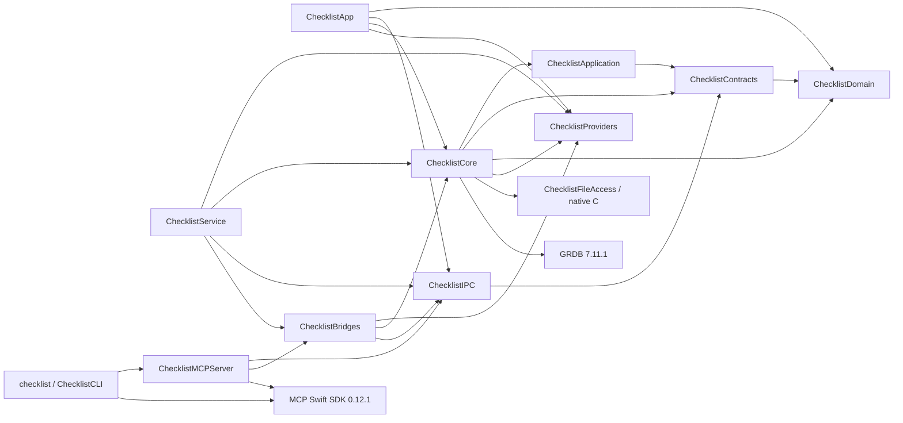

# Monorepo workspace and build ownership

Checklist already has one root SwiftPM workspace. Keep `Package.swift`, `Package.resolved`, `Sources/<target>` and `Tests/<target>` at their current locations. The macOS products remain `ChecklistApp`, `ChecklistService` and `checklist`; their separate names are required on case-insensitive volumes. No server, Windows or Linux product is configured by this preparation.

The shipping product dependency graph is acyclic:

The first real shared package is now extracted by CL-98. See [shared modules](shared-modules.md) for its boundary, compatibility facade and migration ownership.



Both external dependencies use exact root-manifest versions. The committed root `Package.resolved` pins their transitive revisions. Do not regenerate the lock as a side effect of moving a module. Native file previews now import the portable public preview/inspection values from the existing Core target; the app never opens the service database. This adds the App → Core build edge (and its GRDB link dependency), without a schema migration or a second persistence runtime. A future shared-package extraction can move those Foundation-only values behind the compatibility facade. Core tests also declare their existing ChecklistBridges import as a test dependency.

Bridges imports Core’s shared agent-reference formatter; Core has no reverse dependency on Bridges. `ChecklistProviders` is the Foundation-only versioned provider-plugin contract/bundled metadata and interpretation target consumed by Core, App, Bridges and Service. Native transport stays in Bridges and authentication stays in Service. See [provider plugins](provider-plugins.md).

`ChecklistFileAccess` is a small internal C dependency of Core for deadline-bounded descriptor opens. It is linked into the existing products, not a new executable, model runtime or installed service. Only its selected-root syscall walk runs in one reusable native child, with anonymous request/lifetime channels and no inherited store descriptors; relative descendant/file operations run in process, and Core retains authorization, metadata and publication authority. Core tests exercise the child boundary.

Both direct dependencies use exact root-manifest versions. The committed root `Package.resolved` pins their transitive revisions. Do not regenerate the lock as a side effect of moving a module. CL-128 adds the internal provider target and its explicit build edges; CL-173 adds the build aggregation target. External dependency pins, executable identities and runtime/data schema stay unchanged.

## Root commands

Use the installed Swift/Xcode macOS toolchain. From a clean repository checkout, run:

```sh
swift package --force-resolved-versions resolve
swift build --force-resolved-versions --target ChecklistProducts
swift test --force-resolved-versions
python3 scripts/validate-plan.py
```

The last command requires `jsonschema`; use the project's documented Python environment or `uv run --with jsonschema python scripts/validate-plan.py`. Resolution requires access to the exact pinned repositories or a complete local cache. These are build/test commands; they do not install Checklist or mutate its service data. Use a separate `--scratch-path` for concurrent disposable verification, and do not reuse a scratch directory across simultaneous builds. Production builds select the three shipping products explicitly; verification executables such as `StorageCrashProbe` remain in the test build and do not require production modules to enable testability.

App preference regression: `python3 scripts/check-app-test-preferences.py` runs the complete `ChecklistAppTests` suite, then counts test plists at three and six seconds after process exit. Any new file seen at either count fails the check; it only reads Preferences and excludes `Checklist.Workspace.*`. App-test defaults are process-local memory stores, including reopened secondary-window stores supplied through `WorkspaceWindowStorage.workspacePreferences`. Typed accessors still use the `UserDefaults` interface, but no named persistent domain is written or unlinked. This avoids Foundation/cfprefsd recreating empty plists at process exit after per-test cleanup. The child-process regression exits with retained primary/secondary defaults without teardown, then checks both paths after exit. `python3 -m unittest discover -s scripts -p test_check_app_test_preferences.py` checks the external counter's late-write failure and preservation behavior using disposable directories.

`./script/build_and_run.sh --stage` captures source, builds/signs the app and verifies its staged bundle. `./script/build_and_run.sh --verify` additionally replaces `/Applications/Checklist.app`, opens it and checks the service. Staging/signing and installation have effects beyond compiling and require the applicable installation authorization. The helper defaults to release; `CHECKLIST_BUILD_CONFIGURATION=debug` selects debug. It retains the prior compatible application bundle for binary rollback and does not create a database backup. Follow [self-hosting](self-hosting.md) for compatibility and store rollback rules.

The default `CHECKLIST_BUILD_SCOPE=install` reserves the next shared development version. For disposable test-only stages use `CHECKLIST_BUILD_SCOPE=test`; private-copy inspection uses `private-copy`. These local stages record version `<VERSION>.0`, ordinal `0` and `installable:false`, without reserving shared history. A combined round intended for installation keeps `install` even in its private copy; local stages cannot be promoted. See [build versions](self-hosting.md#build-versions).

Test slots reuse that verified stage without another build:

```sh
# Native caller identity must be exported; otherwise add --session-id <actual session ID>.
./script/test_instances.py create --slot 1 --latest-stage
./script/test_instances.py start --slot 1 --headless
./script/test_instances.py check --slot 1
./script/test_instances.py status --json
./script/test_instances.py promote --slot 1 --dry-run
./script/test_instances.py destroy --all
python3 -m unittest discover -s scripts -p test_test_instances.py
```

See [test instances](test-instances.md) for the four isolated identities, backup-seeding limits and mandatory same-build backup check before promotion. `./script/build_and_run.sh --install-stage CAPTURE_DIR` verifies and installs an existing original stage through the ordinary install path; it does not compile again. Like `--verify`, it requires the exact installed app process and healthy parsed service status before success, retaining the prior bundle on failure. The live defaults below remain unchanged; test bundles derive separate values from their own Info.plist.

## Captured build lane and timing

`ChecklistProducts` is a build aggregation target. It depends on `ChecklistApp`, `ChecklistService` and `ChecklistCLI`. One `swift build --target ChecklistProducts` builds and links all three shipping executables. The helper reads `--show-bin-path` once before compilation. It removes only final shipping executables and resource bundles from that output directory, retaining objects and module caches. This prevents a changed manifest or group from reusing a stale final product. It does not build the storage crash or CLI input probes for a shipping stage. SwiftPM's normal build-manifest cache stays enabled. Release remains the default configuration and retains `-O`. Release stages explicitly select `--build-system native` with `-Xswiftc -no-whole-module-optimization -Xswiftc -incremental -Xswiftc -enable-batch-mode`, so unchanged per-file objects and dependency records can be reused. The current Swift Build engine still plans whole-module dependency outputs when these compiler flags alone override release mode; that combination fails with missing dependency files. Native SwiftPM supplies the matching per-file output maps. Debug keeps the toolchain's normal defaults. Requalify this explicit engine selection when upgrading SwiftPM.

The immutable capture remains the build authority. Under `.local/build`, each toolchain/configuration/build-flags/signing profile has a stable `lane-<toolchain-id>/source` path and a separate `swiftpm-<toolchain-id>` scratch path. `script/build_support.py` copies only the verified capture into that lane. It preserves unchanged file bytes and timestamps and removes stale inputs. It checks the complete lane membership, bytes and executable modes against the capture before and after compilation. Extra inputs, symlinks and changed files fail the build. Later checkout edits are reported as provenance and never enter the lane. The toolchain identity includes the selected build engine and every compiler argument; `capture-manifest.json` also records `swift_flags`. A flag change creates a new fingerprint, lane and scratch path rather than reusing outputs from another recipe.

The existing `.local/build/.build-lock` covers capture, lane synchronization, compilation, staging, signing, verification and installation. A second invocation in the same checkout fails before touching the lane or scratch directory. The helper does not queue builds. Ordinary exits and HUP/INT/TERM release the lock even if generated-output cleanup fails; cleanup errors are reported and make an otherwise successful run fail. Uncatchable termination still requires stale-lock reconciliation. Different checkouts have separate build roots. A stale lock requires reconciliation; do not remove a live build's lock or share its lane manually.

`<fingerprint>/build-verification.json` records signed executable hashes and `timing`. The timing record contains total seconds, UTC start, start/end load averages and `phases`. The phases are `capture`, `compile`, `stage`, `sign`, `verify` and `install`. Each phase records seconds and a completed or skipped status. Executed phases also record their start/end load averages. Compile includes lane synchronization, compilation and linking, the binary-path query and the post-build lane check. Compiler and linker times are not independently available from this aggregate receipt; do not report the aggregate as compiler-only time. Verify covers staged signing, icon and captured-source checks. Install covers the existing bundle copy, quiescence, replacement and signature check. Native launch and installed-service qualification follow that installation receipt.

A stage-only run records installation as skipped. Reusing an existing verified stage records compile, stage and sign as skipped. `build-timings.jsonl` retains timing snapshots for repeated uses of a capture. Install modes also copy the timing record into `.local/build/last-install.json`. These records measure elapsed time under the reported host load; they do not control contention from other projects. The first CL-173 change landed in `61aa4b5`; use its parent `0219e5eb209887c7474aa73f0e3228c9db3da673` as the formal pre-ticket baseline. The later `a9c998d` already contains the stable-lane and aggregate-build changes, so its comparison with `e4ec087` does not measure the whole ticket. Complete comparable-load medians of three, including clean-build parity, remain an independent qualification step. Development single runs and fixture checks do not complete that gate.

### Repeatable quiet-window measurements

`--stage` can reuse a completed verified bundle. `--rebuild-stage` deliberately
compiles and stages again for the same capture, retaining the lane and compiled
objects. `--clean-stage` additionally runs `swift package clean` against only the
selected lane's scratch before compilation. Both modes stop after verification;
they never install or open an app. A rebuild preserves the prior stage until
its replacement passes verification. Copied bundle resources gain owner write permission before signing, and
removal restores owner write only within generated stages (including older
read-only stages). Immutable capture bytes and modes stay unchanged. Capture,
compile, assemble and sign have named shell functions for later
version/cleanup hooks; the existing timing phases remain unchanged.

The measurement runner forces `CHECKLIST_BUILD_SCOPE=measurement` for all warmups and measured builds, including clean runs. Scope participates in capture identity while matching toolchains/configurations retain their warm compilation lane. Its local stages consume no shared version or build ordinal and cannot be installed.

Use `script/measure_build_times.py` in an **exclusive private, already-warmed
checkout** of the staged combined build, during a quiet window. Do not run it in
the shared checkout or concurrently with other builds. It temporarily appends a
comment to one Core or App Swift file and restores original bytes and timestamps
on success or ordinary failure. Saved `originals/` bytes in the evidence folder
allow recovery if the runner is killed. Each of the four cases (unchanged, Core change,
App change, clean) runs three times, each preceded by an unmeasured baseline
warmup. A no-change run uses `--rebuild-stage`, so a cached stage cannot masquerade
as a fast compile. The clean cases deliberately discard that helper lane's
compiled outputs, leaving its dependency checkouts and immutable captures in
place. Do not point these clean runs at an implementation pass's warm build slot.

```sh
CHECKLIST_BUILD_CONFIGURATION=release CHECKLIST_SIGN_IDENTITY=- \
  python3 script/measure_build_times.py \
  --checkout /private/tmp/checklist-measure-after \
  --output /private/tmp/checklist-times-after --label after-EXACT-REVISION \
  --source-fingerprint <captured-round-source-fingerprint> \
  --allow-source-edits-and-clean
```

The runner marks the output root with the owning native session, label/purpose and required exact `--source-fingerprint` before saving originals or building. If no native ID is exported, supply `--session-id <actual session ID>`; exported identities cannot be overridden. Keep failed outputs protected for inspection. Mark any separately created enclosing qualification run and warmed checkout at creation too, before source/store copies. After preserving the evidence externally, only the owner releases a disposable run; released obsolete fingerprinted runs under `~/Library/Caches/ChecklistQualification` are eligible for whole-run Trash retirement, while the latest installed round stays. Unmarked runs older than seven days are reported with sizes and never retired automatically. See the [root marker procedure](../skills/checklist/references/driven-sessions.md#scratch-cleanup-and-cache-settings).

If a shared Swift build-slot wrapper applies, run the entire Python command
through that wrapper so its child Swift commands remain in one reserved slot.
The runner requires the two measurement modes above; for an older comparison
revision, backport only these stage-control hooks, preserving its original
compile recipe. Use separate warmed before/after copies with the same toolchain,
configuration and signing selection. Keep both `results.json` files and all raw
logs. Results include 12 measured runs, 12 separately recorded warmups, medians,
start/end load averages, phase receipts, source fingerprints and restored input
hashes. Compare the matching cases only at comparable load; the runner does not
assert the quarter-time target or clean-build parity automatically. No complete
before/after timing comparison was run during the parallel Pass 2 work.

## Complete local package inputs

`Packages/ChecklistShared` contains the first real Domain, Contracts and Application extraction. The root declares `.package(path: "Packages/ChecklistShared")`; target dependencies explicitly name its real products. A local package may depend on other complete local packages under `Packages`, including nested directories. Every source needed by a local path dependency must stay within the captured root; external paths, symlinked packages and nested repositories/submodules are not supported substitutes for captured inputs. No empty package/platform scaffold is required now.

The accepted extraction direction is Domain ← Contracts ← Application. Shared targets must not depend on the root application, GRDB, SwiftUI/AppKit, XPC, credentials, filesystem/process authority or native adapters. Local persistence/native adapters implement application interfaces, and the service composes them. Extract one real command family at a time behind the existing compatibility facade, retaining transaction, wire/hash and provenance behavior. CL-98 creates these initial modules with real root consumers; this extraction proves no non-macOS product support.

`script/build_input_inventory.py` defines the single inventory used before capture and after build. Its own bytes, the build helper and the stage- and installed-verification helpers are inputs. It includes the complete `Packages` tree: root and nested manifests, manifest variants, lockfiles, Sources, Tests, resources and other authored package/contract inputs. In the working Git repository, tracked files remain included even if a later ignore rule matches, and nonignored untracked files are included before staging. Git applies ignore exceptions exactly. The inventory adds no generic `cache` or `build` directory exclusion; actual Git ignore rules still apply.

Package-local `.build`, `.swiftpm`, `.local` and `__pycache__` components are private build/workspace metadata, not authored package inputs. `.DS_Store` remains excluded. Git-ignored untracked material is omitted. Do not place required source/configuration in these reserved metadata directories or rely on unrecorded per-user resolution/mirror settings. The top-level private `.local` tree is not an input root. Both helper bootstraps execute an explicit namespace compiled from already-read source bytes, bypassing cached bytecode. Initial capture matches that executed buffer's hash to its inventory entry. The immutable copy contains no `.git`; verification checks the already-read buffer against the manifest hash, executes that same buffer, then hashes complete allowed input membership against the manifest without consulting current-checkout ignore rules. Source edits after capture are reported separately, not compiled into the captured build.

The service's independent enrolled-repository capture already inventories tracked and nonignored untracked package files generically. It continues to reject submodule pointers and preserve its complete-source limits and checks. Build ownership does not replace that task/review evidence or its authority checks.

## Preserved native and data boundaries

The captured root remains the SwiftPM build authority. Existing staging still copies the three products into `Checklist.app/Contents/MacOS`, SwiftPM resource bundles into `Contents/Resources`, and both `org.checklist.service.plist` and `org.checklist.coordination.plist` into `Contents/Library/LaunchAgents`. Application ID `org.checklist.app`, helper identifiers, Keychain/bootstrap checks and the default `~/Library/Application Support/Checklist` data root are unchanged. No source move, migration, reset or schema change is part of this preparation.

Disposable local-package checks establish inventory/fingerprint/captured-build behavior. A later promoted target still needs the normal root clean resolve/build/test, exact installed helper/resource/signing checks, existing-data readability and independent review; an isolated fixture is not installed-app qualification. Roll back this preparation by restoring the previous inventory/helper and documentation together. Do not delete data or change executable identities to roll back build ownership.

## Local build and hand-in cleanup

After a successful installation (and installed checks for `--verify` and
`--install-stage`), `build_and_run.sh` releases its build lock and starts an
explicit background `post_install_cleanup` step, printing its PID and
`<capture>/post-install-cleanup.jsonl` report path. Cleanup acquires its own build
lease; a concurrent builder makes it refuse safely. Installation returns without
waiting for cleanup, and interactive modes do not hold its lease. Read the report
summary before treating retirement as complete; startup/refusal errors are in the
same log. No schedule or persistent worker is created. Cleanup moves obsolete
capture `source`, staged app, binaries and per-capture build outputs to the Trash, retaining the installed and immediate
previous captures. All receipt files, timing history and unknown files remain in
the older capture directories. It also retires legacy `swiftpm-<id>` scratch
without a paired `lane-<id>/source`. Paired lanes for every configuration remain
warm. Stage-only and failed install runs do not retire anything. Cleanup failure
is logged without turning a successful install into a failed installation.
Build outputs move in one native Trash batch (45-second transport timeout), with
individual destinations/errors and confirmed logical-byte totals. A failed batch
can have successful individual moves; those receipts remain in the report. Only
a selected read-only directory root gains owner write permission for the move;
its nested directories, files, parents and every retained capture keep their
permissions. A failed move restores that root’s original mode. SwiftPM scratch
may contain relative or absolute symlinks whose immediate and resolved targets
remain inside that same scratch folder. External, cyclic or unresolved links
retain the entire scratch folder and report the offending link path. No external
target exceptions are currently needed or allowed.

For leftover builds, hand-ins and idle slots, run from the project checkout:

```sh
python3 script/clean_builds.py --preview
# Save and inspect the per-item JSON report, then within the authorized scope:
python3 script/clean_builds.py --apply
```

Use `--only builds|evidence|slots` to bound the pass and repeat `--keep PATH` for
assigned slots, unfinished hand-ins and retained qualification copies. Manual
build cleanup takes the same `.build-lock` as the builder; a held lock refuses
cleanup. Preview, apply and the post-install hook share `clean_scratch.py`'s
workspace marker protection: an unreleased `.checklist-workspace.json` at an
item's root, below it or above it keeps the whole item. Malformed, unreadable or
linked markers also keep it and report why. Released markers remove only their
own protection; all other safeguards still apply. Unmarked legacy persistent
workspace names remain protected by the shared migration guard. Apply rechecks
markers before moving evidence, build outputs or slots.
The installed bundle and newest unambiguous `.Checklist-previous-<timestamp>-<pid>.app`
bundle identify the installed and immediate previous captures, even when a private
integration copy performed the install and the checkout's `last-install.json` is
stale or absent. An unreadable identity or ambiguous newest rollback bundle retains
every build. A matching receipt that names a missing/unreadable predecessor also
retains every build instead of substituting an older surviving bundle. A newer
rollback bundle supersedes that receipt, including a same-fingerprint reinstall
from another copy. With no rollback bundle, only a matching install receipt
explicitly recording no predecessor permits retirement; an unavailable
predecessor retains builds.
Captures used directly by running processes, or identified by running Checklist
bundles (including test-slot and renamed app bundles), remain intact. Unknown
build layouts are kept.

Evidence is scoped by ticket keys in the folder name and `files.json` ticket
fields. A round folder may explicitly declare **every** owning ticket with
`cleanup.json` containing `{"tickets":["CL-10","CL-11"]}` (strings or
`{"key": ...}` rows). A `cleanup.json` without `tickets` is a cleanup receipt, not
ownership. Untagged containers and their logs stay; their ticket children can
retire separately. Every older `files.json` shape is read without an error: a list
of entries, `{"files": [...]}`, a `{name: {...}}` map, and `ticket` (string or
list) or `tickets` on an entry or at the top level. When the entries have no ticket
key, the ticket keys in the folder name are the owners, and the note's
`owner_basis` says so. Ticket keys in nested file names add owners but never
establish ownership alone. A folder with no owner key ("unknown owner") or an
unreadable record stays as `kept` and does not fail the run. Every owning
ticket must have `status_category` `done` or `canceled` (CL-359); open, missing,
ambiguous or unreadable statuses retain the evidence. The default status reader uses only
`project_resolve` and paginated `task_list` calls through the installed CLI, with
its cwd set to the project folder. It never reads the live database directly.
Alternatively, supply `--project-id ID --status-file PATH` with an explicit
`{"project_id":"ID","tasks":[{"key":"CL-10","status_category":"done"}]}`
list. This is an operator-supplied status snapshot; refresh it before applying.

Evidence notes (CL-359): `--evidence-notes PATH` writes one JSON line per owning
ticket for each evidence folder that retires. The note gives the folder name, file
count, logical bytes, the SHA-256 of each `notes.md` and `report.md`, the
`files.json` hand-in paths, the owner basis and the names of the files attached
to the ticket (read-only `attachment_list`, with task IDs from the same batched
`task_list` status read). The preview reads all statuses in one batched read,
reads attachments in parallel and runs the `du` sizes while it inspects the
folders; apply reads each status again before a move. The notes file is written for
every eligible folder even when another folder reports `kept_error`; the exit code is
1 only for a real failure (status, process or file read, or a move). With `--apply --post-notes`, the
command sends each note to its ticket with `message_send` (an agent action) before
the folder moves. If a note fails, the folder stays and the run reports an error.
Evidence of open tickets stays.

Size budget (CL-359): each `clean_builds.py` and `clean_scratch.py` run ends with
one `size_report` JSON line. It gives the `du -sk` sizes of the session scratch
folders, `.local/evidence`, `.local/build` and
`~/Library/Caches/ChecklistQualification` (a `--only` run reports only its own
group). Above `--budget-gb` (default 50, or `CHECKLIST_CLEANUP_BUDGET_GB`), the run
also writes a `WARNING: CLEANUP BUDGET EXCEEDED` line to stderr. Bytes in the Trash
stay on disk until the owner empties the Trash.

Preview is read-only and apply computes new decisions, inventories and process
observations. Preview caches one process snapshot for the pass; build apply
refreshes it once before the batch, then rechecks inventories and installation
identity under the build lease. Process paths are deduplicated before resolution
and indexed by ancestors once, rather than resolved/scanned for every item.
Evidence apply takes one initial process snapshot for eligible items and one
fresh snapshot before its Trash batch, rechecking only selected trees, markers
and current ticket statuses. Retained containers and policy refusals need no
process observation. Each top-level evidence tree is inventoried once for
inspection; container sizes are summed bottom-up. Hand-in discovery stops at
store roots (directories containing `checklist.sqlite` or `database.sqlite`),
`managed`, `source-captures`, `source`, `src` and `.build` trees, and unscoped
containers with no ticket hand-ins. Those containers stay and report their full
logical size and retention reason; their contents are never independent cleanup
candidates. Scoped hand-ins still inspect every descendant for ownership and
protection, and selected trees are inventoried again before moving.
Live data, installed/rollback apps, in-use paths, links outside the SwiftPM
exception above and unknown ownership are retained. Process inspection failure
refuses retirement. Every item reports its path, logical byte count and reason; successful moves report a
Trash destination and a total `bytes_removed`. These are bytes moved out of the
working folders, not recovered disk space; Trash retains them. Other tools must
honor the build/slot leases; external noncooperating writers can still race a
filesystem inspection, so do not run cleanup during unrelated manual writes.

Slot lifecycle and bounded-check cleanup are described in
[test instances](test-instances.md#cleanup-after-bounded-checks). This command is
separate from `clean_scratch.py`, which handles session scratch and qualification
caches and never retires hand-in evidence.
