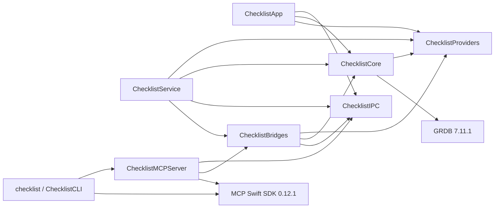

# Monorepo workspace and build ownership

Checklist already has one root SwiftPM workspace. Keep `Package.swift`, `Package.resolved`, `Sources/<target>` and `Tests/<target>` at their current locations. The macOS products remain `ChecklistApp`, `ChecklistService` and `checklist`; their separate names are required on case-insensitive volumes. No server, Windows or Linux product is configured by this preparation.

The shipping product dependency graph is acyclic:



Both external dependencies use exact root-manifest versions. The committed root `Package.resolved` pins their transitive revisions. Do not regenerate the lock as a side effect of moving a module. Native file previews now import the portable public preview/inspection values from the existing Core target; the app never opens the service database. This adds the App → Core build edge (and its GRDB link dependency), without a schema migration or a second persistence runtime. A future shared-package extraction can move those Foundation-only values behind the compatibility facade. Core tests also declare their existing ChecklistBridges import as a test dependency.

Bridges imports Core’s shared agent-reference formatter; Core has no reverse dependency on Bridges. `ChecklistProviders` is the Foundation-only versioned provider-plugin contract/bundled metadata and interpretation target consumed by Core, App, Bridges and Service. Native transport stays in Bridges and authentication stays in Service. See [provider plugins](provider-plugins.md).

Both direct dependencies use exact root-manifest versions. The committed root `Package.resolved` pins their transitive revisions. Do not regenerate the lock as a side effect of moving a module. CL-128 adds the internal provider target and its explicit build edges; CL-173 adds the build aggregation target. External dependency pins, executable identities and runtime/data schema stay unchanged.

## Root commands

Use the installed Swift/Xcode macOS toolchain. From a clean repository checkout, run:

```sh
swift package --force-resolved-versions resolve
swift build --force-resolved-versions --target ChecklistProducts
swift test --force-resolved-versions
python3 scripts/validate-plan.py
```

The last command requires `jsonschema`; use the project's documented Python environment or `uv run --with jsonschema python scripts/validate-plan.py`. Resolution requires access to the exact pinned repositories or a complete local cache. These are build/test commands; they do not install Checklist or mutate its service data. Use a separate `--scratch-path` for concurrent disposable verification, and do not reuse a scratch directory across simultaneous builds. Production builds select the three shipping products explicitly; verification executables such as `StorageCrashProbe` remain in the test build and do not require production modules to enable testability.

App preference regression: `python3 scripts/check-app-test-preferences.py` runs the complete `ChecklistAppTests` suite, then counts test plists at three and six seconds after process exit. Any new file seen at either count fails the check; it only reads Preferences and excludes `Checklist.Workspace.*`. App-test defaults are process-local memory stores, including reopened secondary-window stores supplied through `WorkspaceWindowStorage.workspacePreferences`. Typed accessors still use the `UserDefaults` interface, but no named persistent domain is written or unlinked. This avoids Foundation/cfprefsd recreating empty plists at process exit after per-test cleanup. The child-process regression exits with retained primary/secondary defaults without teardown, then checks both paths after exit. `python3 -m unittest discover -s scripts -p test_check_app_test_preferences.py` checks the external counter's late-write failure and preservation behavior using disposable directories.

`./script/build_and_run.sh --stage` captures source, builds/signs the app and verifies its staged bundle. `./script/build_and_run.sh --verify` additionally replaces `/Applications/Checklist.app`, opens it and checks the service. Staging/signing and installation have effects beyond compiling and require the applicable installation authorization. The helper defaults to release; `CHECKLIST_BUILD_CONFIGURATION=debug` selects debug. It retains the prior compatible application bundle for binary rollback and does not create a database backup. Follow [self-hosting](self-hosting.md) for compatibility and store rollback rules.

Test slots reuse that verified stage without another build:

```sh
./script/test_instances.py create --slot 1 --latest-stage
./script/test_instances.py start --slot 1 --headless
./script/test_instances.py check --slot 1
./script/test_instances.py status --json
./script/test_instances.py promote --slot 1 --dry-run
./script/test_instances.py destroy --all
python3 -m unittest discover -s scripts -p test_test_instances.py
```

See [test instances](test-instances.md) for the four isolated identities, backup-seeding limits and mandatory same-build backup check before promotion. `./script/build_and_run.sh --install-stage CAPTURE_DIR` verifies and installs an existing original stage through the ordinary install path; it does not compile again. Like `--verify`, it requires the exact installed app process and healthy parsed service status before success, retaining the prior bundle on failure. The live defaults below remain unchanged; test bundles derive separate values from their own Info.plist.

## Captured build lane and timing

`ChecklistProducts` is a build aggregation target. It depends on `ChecklistApp`, `ChecklistService` and `ChecklistCLI`. One `swift build --target ChecklistProducts` builds and links all three shipping executables. The helper reads `--show-bin-path` once before compilation. It removes only final shipping executables and resource bundles from that output directory, retaining objects and module caches. This prevents a changed manifest or group from reusing a stale final product. It does not build the storage crash or CLI input probes for a shipping stage. SwiftPM's normal build-manifest cache stays enabled. Release remains the default configuration.

The immutable capture remains the build authority. Under `.local/build`, each toolchain/configuration/signing profile has a stable `lane-<toolchain-id>/source` path and a separate `swiftpm-<toolchain-id>` scratch path. `script/build_support.py` copies only the verified capture into that lane. It preserves unchanged file bytes and timestamps and removes stale inputs. It checks the complete lane membership, bytes and executable modes against the capture before and after compilation. Extra inputs, symlinks and changed files fail the build. Later checkout edits are reported as provenance and never enter the lane.

The existing `.local/build/.build-lock` covers capture, lane synchronization, compilation, staging, signing, verification and installation. A second invocation in the same checkout fails before touching the lane or scratch directory. The helper does not queue builds. Different checkouts have separate build roots. A stale lock requires reconciliation; do not remove a live build's lock or share its lane manually.

`<fingerprint>/build-verification.json` records signed executable hashes and `timing`. The timing record contains total seconds, UTC start, start/end load averages and `phases`. The phases are `capture`, `compile`, `stage`, `sign`, `verify` and `install`. Each phase records seconds and a completed or skipped status. Executed phases also record their start/end load averages. Compile includes lane synchronization, compilation, the binary-path query and the post-build lane check. Verify covers staged signing, icon and captured-source checks. Install covers the existing bundle copy, quiescence, replacement and signature check. Native launch and installed-service qualification follow that installation receipt.

A stage-only run records installation as skipped. Reusing an existing verified stage records compile, stage and sign as skipped. `build-timings.jsonl` retains timing snapshots for repeated uses of a capture. Install modes also copy the timing record into `.local/build/last-install.json`. These records measure elapsed time under the reported host load; they do not control contention from other projects. CL-173 has no completed application timing comparison yet. Native fixture checks establish aggregation, resource regeneration and capture isolation; they do not establish the requested application speedup.

### Repeatable quiet-window measurements

`--stage` can reuse a completed verified bundle. `--rebuild-stage` deliberately
compiles and stages again for the same capture, retaining the lane and compiled
objects. `--clean-stage` additionally runs `swift package clean` against only the
selected lane's scratch before compilation. Both modes stop after verification;
they never install or open an app. A failed rebuild keeps the prior verified
stage. Capture, compile, assemble and sign have named shell functions for later
version/cleanup hooks; the existing timing phases remain unchanged.

Use `script/measure_build_times.py` in an **exclusive private, already-warmed
checkout** of the staged combined build, during a quiet window. Do not run it in
the shared checkout or concurrently with other builds. It temporarily appends a
comment to one Core or App Swift file and restores original bytes and timestamps
on success or ordinary failure. Saved `originals/` bytes in the evidence folder
allow recovery if the runner is killed. Each of the four cases (unchanged, Core change,
App change, clean) runs three times, each preceded by an unmeasured baseline
warmup. A no-change run uses `--rebuild-stage`, so a cached stage cannot masquerade
as a fast compile. The clean cases deliberately discard that helper lane's
compiled outputs, leaving its dependency checkouts and immutable captures in
place. Do not point these clean runs at an implementation pass's warm build slot.

```sh
CHECKLIST_BUILD_CONFIGURATION=release CHECKLIST_SIGN_IDENTITY=- \
  python3 script/measure_build_times.py \
  --checkout /private/tmp/checklist-measure-after \
  --output /private/tmp/checklist-times-after --label after-EXACT-REVISION \
  --allow-source-edits-and-clean
```

If a shared Swift build-slot wrapper applies, run the entire Python command
through that wrapper so its child Swift commands remain in one reserved slot.
The runner requires the two measurement modes above; for an older comparison
revision, backport only these stage-control hooks, preserving its original
compile recipe. Use separate warmed before/after copies with the same toolchain,
configuration and signing selection. Keep both `results.json` files and all raw
logs. Results include 12 measured runs, 12 separately recorded warmups, medians,
start/end load averages, phase receipts, source fingerprints and restored input
hashes. Compare the matching cases only at comparable load; the runner does not
assert the quarter-time target or clean-build parity automatically. No complete
before/after timing comparison was run during the parallel Pass 2 work.

## Complete local package inputs

Create `Packages/ChecklistShared` only when the first real shared implementation is extracted. The root then declares `.package(path: "Packages/ChecklistShared")`; target dependencies explicitly name its real products. A local package may depend on other complete local packages under `Packages`, including nested directories. Every source needed by a local path dependency must stay within the captured root; external paths, symlinked packages and nested repositories/submodules are not supported substitutes for captured inputs. No empty package/platform scaffold is required now.

The accepted extraction direction is Domain ← Contracts ← Application. Shared targets must not depend on the root application, GRDB, SwiftUI/AppKit, XPC, credentials, filesystem/process authority or native adapters. Local persistence/native adapters implement application interfaces, and the service composes them. Extract one real command family at a time behind the existing compatibility facade, retaining transaction, wire/hash and provenance behavior. This preparation creates none of those modules and proves no non-macOS support.

`script/build_input_inventory.py` defines the single inventory used before capture and after build. Its own bytes, the build helper and the stage- and installed-verification helpers are inputs. It includes the complete `Packages` tree: root and nested manifests, manifest variants, lockfiles, Sources, Tests, resources and other authored package/contract inputs. In the working Git repository, tracked files remain included even if a later ignore rule matches, and nonignored untracked files are included before staging. Git applies ignore exceptions exactly. The inventory adds no generic `cache` or `build` directory exclusion; actual Git ignore rules still apply.

Package-local `.build`, `.swiftpm`, `.local` and `__pycache__` components are private build/workspace metadata, not authored package inputs. `.DS_Store` remains excluded. Git-ignored untracked material is omitted. Do not place required source/configuration in these reserved metadata directories or rely on unrecorded per-user resolution/mirror settings. The top-level private `.local` tree is not an input root. Both helper bootstraps execute an explicit namespace compiled from already-read source bytes, bypassing cached bytecode. Initial capture matches that executed buffer's hash to its inventory entry. The immutable copy contains no `.git`; verification checks the already-read buffer against the manifest hash, executes that same buffer, then hashes complete allowed input membership against the manifest without consulting current-checkout ignore rules. Source edits after capture are reported separately, not compiled into the captured build.

The service's independent enrolled-repository capture already inventories tracked and nonignored untracked package files generically. It continues to reject submodule pointers and preserve its complete-source limits and checks. Build ownership does not replace that task/review evidence or its authority checks.

## Preserved native and data boundaries

The captured root remains the SwiftPM build authority. Existing staging still copies the three products into `Checklist.app/Contents/MacOS`, SwiftPM resource bundles into `Contents/Resources`, and both `org.checklist.service.plist` and `org.checklist.coordination.plist` into `Contents/Library/LaunchAgents`. Application ID `org.checklist.app`, helper identifiers, Keychain/bootstrap checks and the default `~/Library/Application Support/Checklist` data root are unchanged. No source move, migration, reset or schema change is part of this preparation.

Disposable local-package checks establish inventory/fingerprint/captured-build behavior. A later promoted target still needs the normal root clean resolve/build/test, exact installed helper/resource/signing checks, existing-data readability and independent review; an isolated fixture is not installed-app qualification. Roll back this preparation by restoring the previous inventory/helper and documentation together. Do not delete data or change executable identities to roll back build ownership.
